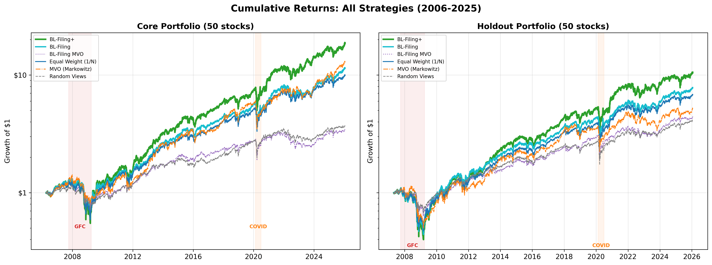
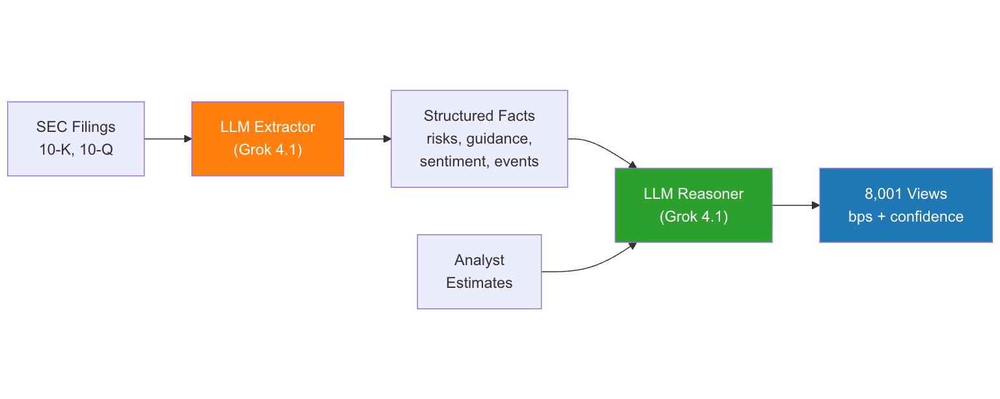
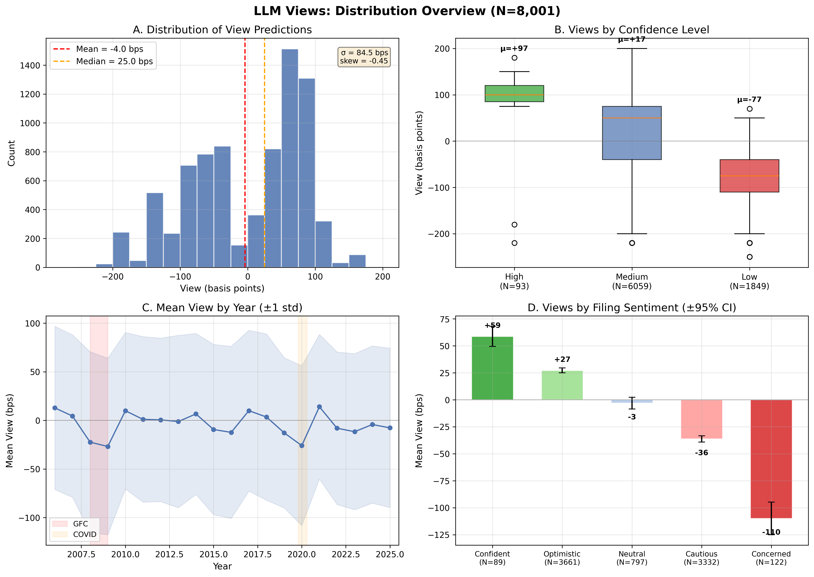

# Filing-Aware LLM Views for Portfolio Optimization

A two-stage LLM pipeline that extracts structured investment signals from SEC filings (10-K, 10-Q) and integrates them into Black-Litterman portfolio optimization via weight tilting.

## Key Results

| Strategy | Sharpe (Core) | Sharpe (Holdout) | Ann. Return (Core) | Total Return (Core) |
|----------|:---:|:---:|:---:|:---:|
| **BL-Filing+ (ours)** | **0.569** | **0.463** | **16.0%** | **1775%** |
| MVO | 0.544 | 0.328 | 13.9% | 1206% |
| BL-Filing | 0.498 | 0.439 | 13.1% | 1049% |
| Equal Weight | 0.502 | 0.424 | 12.4% | 900% |
| Random Views | 0.334 | — | 6.9% | 271% |

> BL-Filing+ significantly outperforms Equal Weight (p=0.007) and Random Views (p=0.006) over 20 years of backtesting (2006-2025).



## Architecture

The system uses a two-stage LLM pipeline aligned with quarterly SEC filing cycles:



**Stage 1 — Extraction:** Grok 4.1 Fast parses raw SEC filings (10-K, 10-Q) into structured JSON: risk factors (19 categories), management guidance, sentiment (5 levels), and key events.

**Stage 2 — Reasoning:** The same LLM combines extracted facts with analyst consensus estimates to produce quantitative investment views in basis points (bps) with confidence levels (high / medium / low).

**Portfolio Construction:** Views are integrated into the Black-Litterman framework. Instead of MVO (which suffers from estimation error), we use **weight tilting**: `w_i = w_eq * (1 + tilt_strength * z_i)`, where `z_i` are z-scores of BL posterior returns. This preserves diversification while expressing LLM views.

**Rebalancing:** Quarterly, aligned with 10-Q filing publication cycles (~45 days after quarter end). 80 rebalancing dates over 20 years.

## Dataset

- **100 S&P 500 companies** (50 core / 50 holdout), balanced by GICS sector
- **8,001 SEC filings** (10-K and 10-Q) over 2006-2025
- **8,001 LLM-generated investment views** with confidence and sentiment

### Views Distribution



### Out-of-Sample Validation

The holdout portfolio (50 unseen stocks) validates that the method generalizes — it is not overfitted to the core universe.


## Robustness

- **Bootstrap CI (95%):** BL-Filing+ Sharpe [0.086, 1.123], all filing-based strategies significantly > 0
- **Pairwise significance:** BL-Filing+ vs EW p=0.007, vs Random Views p=0.006
- **10 random stock splits (50/50):** BL-Filing+ Sharpe 0.509 +/- 0.028 (most stable), MVO 0.400 +/- 0.065
- **Calibration/Validation split:** BL-Filing+ #1 in both 2006-2015 (0.542) and 2016-2025 (0.692)
- **Excluding 2009 (GFC recovery):** BL-Filing+ still #1 (Sharpe 0.536, Return 14.3%)
- **Regime analysis:** BL-Filing+ best in 4/6 market regimes on holdout

## Project Structure

```
.
├── scripts/                    # Pipeline scripts (run in order)
├── src/
│   ├── data/                   # FMP API client
│   ├── extraction/             # LLM fact extraction (Stage 1)
│   ├── reasoning/              # LLM view generation (Stage 2)
│   ├── optimization/           # Black-Litterman & weight tilting
│   └── backtesting/            # Backtest engine & metrics
├── config/
│   ├── config.example.yaml     # Configuration template
│   └── universe.yaml           # 100 selected companies
├── data/
│   ├── extracted.zip           # Structured facts from SEC filings (JSON, zipped)
│   ├── views.zip               # Generated investment views (JSON, zipped)
│   └── results/                # Backtest results (core/holdout/robustness)
├── figures/                    # Charts and diagrams
└── requirements.txt
```

## Pipeline

The scripts must be executed in the following order. Each step depends on the output of the previous one.

### Step 1: Download Raw Data
```bash
python scripts/download_raw_data.py
```
Downloads stock prices, financial statements (income, balance sheet, cash flow), analyst estimates, and stock splits from the [Financial Modeling Prep](https://financialmodelingprep.com) API. Output: `data/raw/{TICKER}/`.

### Step 2: Download SEC Filings
```bash
python scripts/download_sec_filings.py
```
Downloads 10-K and 10-Q filing HTML documents from SEC EDGAR. Output: `data/raw/{TICKER}/filings/`.

### Step 3: Extract Facts (LLM Stage 1)
```bash
python scripts/extract_facts.py
# Supports: --ticker AMZN (single), --resume (continue interrupted run)
```
Sends SEC filing text to Grok 4.1 Fast via OpenRouter API. Extracts structured facts: risk factors, guidance, sentiment, key events. Output: `data/extracted/{TICKER}/{FORM}_{DATE}.json`.

### Step 4: Generate Views (LLM Stage 2)
```bash
python scripts/generate_views.py
```
Combines extracted facts with analyst consensus estimates to produce quantitative investment views (in basis points) with confidence levels. Output: `data/views/{TICKER}/view_{DATE}.json`.

### Step 5: Run Backtest
```bash
python scripts/run_backtest.py
```
Runs the full backtest: constructs Black-Litterman portfolios with weight tilting, compares against baselines (Equal Weight, MVO, Random Views). Quarterly rebalancing, 10 bps transaction costs. Output: `data/results/core/` and `data/results/holdout/`.

### Step 6: Run Robustness Tests
```bash
python scripts/run_robustness_tests.py
```
Bootstrap confidence intervals, pairwise significance tests, 10 random stock splits, calibration/validation split, regime analysis. Output: `data/results/robustness/`.

### Step 7: Generate Figures
```bash
python scripts/plot_backtest_results.py
python scripts/plot_views_analysis.py
```
Generates all charts for the paper: cumulative returns, drawdowns, rolling Sharpe, regime performance, views distribution, etc. Output: `figures/`.

## Setup

### Prerequisites
- Python 3.10+
- [FMP API key](https://financialmodelingprep.com) (for financial data)
- [OpenRouter API key](https://openrouter.ai) (for Grok 4.1 Fast LLM access)

### Installation

```bash
git clone https://github.com/oleksii-ivanov-ksu/FilingAwareLLMViewsforPortfolioOptimization.git
cd FilingAwareLLMViewsforPortfolioOptimization

python -m venv .venv
source .venv/bin/activate
pip install -r requirements.txt
```

### Unpack Data

The extracted facts and views are shipped as zip archives to reduce repository size. Unpack them before running the backtest:

```bash
cd data
unzip extracted.zip
unzip views.zip
cd ..
```

This will create `data/extracted/` (~56 MB, 9,100 JSON files) and `data/views/` (~32 MB, 8,000 JSON files).

### Configuration

```bash
cp config/config.example.yaml config/config.yaml
# Edit config/config.yaml and add your API keys
```

## Key Parameters

| Parameter | Value | Description |
|-----------|-------|-------------|
| Rebalancing | Quarterly | Aligned with 10-Q filing cycles |
| tau | 0.05 | BL uncertainty in prior |
| delta | 2.5 | Risk aversion coefficient |
| Max weight | 10% | Per-stock concentration limit |
| Transaction cost | 10 bps | Round-trip |
| Tilt strength | 0.5 | Weight tilting intensity |
| Views filter | Medium confidence, positive only | For BL-Filing+ strategy |

## Limitations

- **Survivorship bias** — universe selected from current S&P 500 constituents
- **LLM reproducibility** — Grok 4.1 Fast is a proprietary model; results may vary across versions
- **Information Coefficient ~ 0** — views do not predict returns cross-sectionally; alpha comes from Bayesian integration with market prior via BL framework
- **Transaction costs** — 10 bps is realistic for institutional investors, not retail

## Citation

```
@misc{filing_aware_llm_2026,
  title={Filing-Aware LLM Views for Portfolio Optimization},
  year={2026}
}
```

## License

This project is for academic/research purposes.