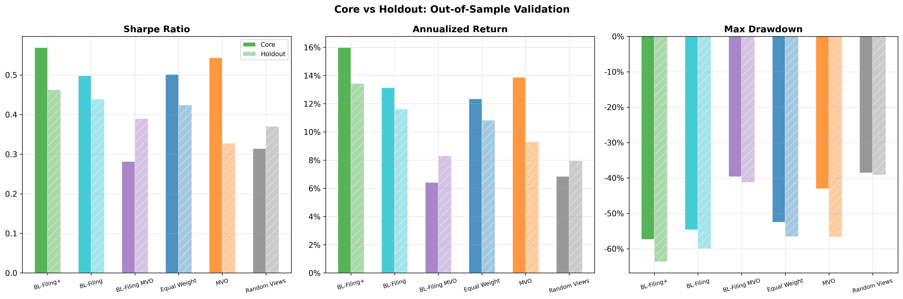
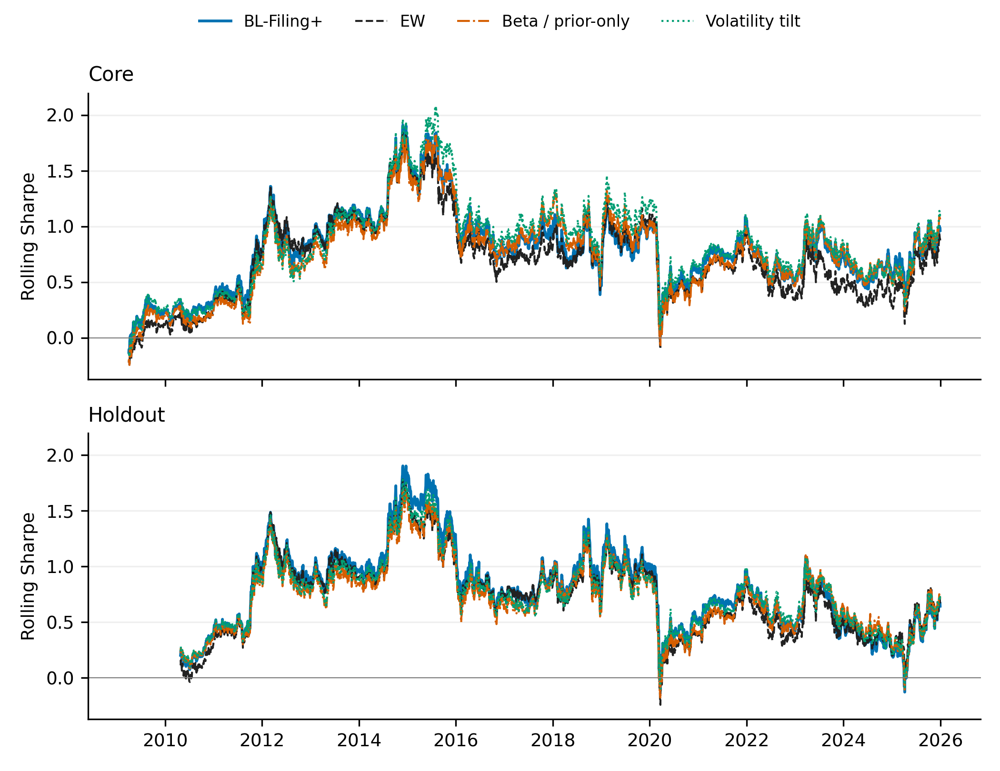

# Integrating Corporate Filings into Black–Litterman Portfolio Construction with LLMs

A two-stage LLM pipeline that extracts structured investment signals from SEC filings (10-K, 10-Q) and integrates them into Black-Litterman portfolio optimization via weight tilting.

## Key Results

| Strategy | Sharpe (Core) | Sharpe (Holdout) | CAGR (Core) | CAGR (Holdout) |
|----------|:---:|:---:|:---:|:---:|
| **BL-Filing+ (ours)** | **0.635** | **0.547** | **15.67%** | **13.24%** |
| MVO | 0.603 | 0.402 | 13.62% | 8.82% |
| BL-Filing | 0.570 | 0.515 | 13.01% | 11.47% |
| Equal Weight | 0.565 | 0.496 | 12.19% | 10.66% |
| Random Views | 0.370 | 0.424 | 6.73% | 7.78% |
| BL-Filing MVO | 0.340 | 0.440 | 6.27% | 8.09% |

> BL-Filing+ has higher historical compounded returns in both stock groups, with
> greater volatility and deeper drawdowns. Paired 95% intervals for its Sharpe
> advantage over equal weighting include zero; Sharpe superiority is not established.

**Updated reporting:** results end on 31 December 2025. Core has 4,969 daily
observations from 3 April 2006; Holdout has 4,701 from 27 April 2007. Sharpe uses
arithmetic daily excess returns and a constant 2% annual risk-free assumption.
The earlier `(CAGR − 2%)/volatility` convention and 13 observations in January 2026
are excluded. Saved historical returns have not been overwritten.

*The original figures below are retained as historical illustrations. Their
metrics and reporting windows may differ from the revised table above.*


## Architecture

The system uses a two-stage LLM pipeline aligned with quarterly SEC filing cycles:


**Stage 1 — Extraction:** Grok 4.1 Fast parses raw SEC filings (10-K, 10-Q) into structured JSON: risk factors (19 categories), management guidance, sentiment (5 levels), and key events.

**Stage 2 — Reasoning:** The same LLM combines extracted facts with analyst consensus estimates to produce quantitative investment views in basis points (bps) with confidence levels (high / medium / low).

**Portfolio Construction:** Views are integrated into the Black-Litterman framework. The primary configuration uses **weight tilting**: `w_i = w_eq * (1 + tilt_strength * z_i)`, where `z_i` are z-scores of BL posterior returns. Preliminary weights are clipped and normalized; final weights need not remain within the preliminary clipping bounds.

**Rebalancing:** Quarterly, using the latest eligible view aged at most 120 days. The saved outputs contain 80 target-weight records per stock group. New weights apply to the following trading day’s close-to-close return.

## Dataset

- **100 S&P 500 companies** (50 core / 50 holdout), balanced by GICS sector
- **8,001 SEC filings** (10-K and 10-Q) over 2006-2025
- **8,001 LLM-generated investment views** with confidence and sentiment

### Views Distribution


### Cross-Company Holdout Comparison

The Holdout portfolio contains 50 separate stocks. It provides a cross-company comparison over substantially the same historical period; it does not establish temporal out-of-sample validity or eliminate model-training leakage.



## Robustness

**Revised paired comparisons:** 10,000 circular moving-block bootstrap draws,
with a main block length of 21 trading days and checks at 5 and 63 days.
BL-Filing+ minus EW arithmetic-Sharpe intervals are **[−0.042, 0.171]** in Core
and **[−0.044, 0.143]** in Holdout. All six main Sharpe-contrast intervals include
zero. Mean-return tests are separate from Sharpe comparisons.
[Revised comparisons](experiments/informatica_2026/paper/informatica/tables/paired_comparisons.md).

<details>
<summary>Original robustness outputs (legacy metric and sample conventions)</summary>

The following archived results use the original reporting conventions. They are
retained for provenance and should not be read as tests of the revised Sharpe
advantage. In particular, the original pairwise p-values concern mean returns.


- **Bootstrap CI (95%):** BL-Filing+ Sharpe [0.086, 1.123], all filing-based strategies significantly > 0
- **Pairwise significance:** BL-Filing+ vs EW p=0.007, vs Random Views p=0.006
- **10 random stock splits (50/50):** BL-Filing+ Sharpe 0.509 +/- 0.028 (most stable), MVO 0.400 +/- 0.065
- **Calibration/Validation split:** BL-Filing+ #1 in both 2006-2015 (0.542) and 2016-2025 (0.692)
- **Excluding 2009 (GFC recovery):** BL-Filing+ still #1 (Sharpe 0.536, Return 14.3%)
- **Regime analysis:** BL-Filing+ best in 4/6 market regimes on holdout

</details>

## New Experiments

The historical extraction and views used **Grok 4.1 Fast**. The new diagnostics
use **Grok 4.3**, with three fresh responses per condition. They test the
second-stage view-to-weight interface and do not replace the historical backtest.

| Experiment | Inputs / responses | Main result | Materials |
|---|---|---|---|
| Identifier-masking pilot | 50 documents / **300** | Mean masked-minus-original view −10.77 bps; mean absolute change 13.57 bps; Spearman 0.9593 | [Protocol](experiments/informatica_2026/docs/informatica/PILOT_PROTOCOL.md) · [Results](experiments/informatica_2026/docs/informatica/PILOT_RESULTS.md) |
| Portfolio-slice masking | 199 inputs / **1,194** | Mean-weight distance 6.84–12.47% of capital; cross-minus-within distance −0.61 to 1.74 percentage points | [Protocol](experiments/informatica_2026/docs/informatica/PORTFOLIO_MASKING_PROTOCOL.md) · [Results](experiments/informatica_2026/docs/informatica/PORTFOLIO_MASKING_RESULTS.md) |
| Filing-summary ablation | 199 inputs / **1,791** | Removing summaries changes mean views by 26.88 bps in absolute terms; using another company's summaries changes them by 36.88 bps | [Protocol](experiments/informatica_2026/docs/informatica/TEXT_ABLATION_PROTOCOL.md) · [Results](experiments/informatica_2026/docs/informatica/TEXT_ABLATION_RESULTS.md) |

The two 199-input experiments use Core and Holdout on 30 September 2015 and
30 September 2025. One stock lacks an eligible view. The first pilot masks more
identifying context than the portfolio experiment; their results are not pooled.

In the summary ablation, financial context is fixed across own-summary,
no-summary and shuffled-summary conditions. Cross-condition weight differences
exceed average repeat variability in all four slices: by 3.96–10.86 percentage
points for own/no summaries and 5.41–13.54 for own/shuffled summaries. Distances
are half-L1, or capital reallocated in one direction.

**Interpretation:** filing summaries affect views and weights. This does not
establish that they caused the historical return advantage. Masking also shows
substantial variability between repeated requests and does not remove temporal
leakage. [Matched historical controls](experiments/informatica_2026/docs/informatica/MATCHED_CONTROLS_RESULTS.md)
retain much of the observed Sharpe: prior-only tilting 0.600/0.515 and eligible-only
reassignment medians 0.631/0.541, versus 0.635/0.547 for real views. Real-minus-control
intervals include zero.

## V2 Signal and Risk Diagnostics

The separate evaluation revision, **Evaluating LLM-Based Integration of Corporate
Filings into Black–Litterman Portfolio Construction**, adds offline checks of the
signal and allocator. The historical return table above is unchanged.

| Diagnostic | Core | Holdout |
|---|---:|---:|
| Mean next-quarter rank IC, 79 dates | −0.018 | −0.021 |
| IC Holm-adjusted p-value | 0.563 | 0.563 |
| BL-Filing+ Sharpe | 0.635 | 0.547 |
| Beta / prior-only tilt Sharpe | 0.600 | 0.515 |
| Volatility tilt Sharpe | 0.681 | 0.545 |
| Quarterly-horizon BL Sharpe | 0.624 | 0.522 |
| Real-minus-prior four-factor alpha, p.p./year | 0.36 | 0.63 |
| Alpha raw p-value | 0.709 | 0.504 |

Prior-only weights coincide with a beta tilt against the within-group equal-weight
return (maximum difference 1.25 × 10⁻¹⁶). This follows from the equal-weight
covariance prior, scalar-identity shrinkage and cross-sectional z-normalization.
The new controls do not establish an incremental LLM-view advantage. Positive
historical CAGR relative to EW and sensitivity to filing text remain distinct
findings; neither is a clean test of predictive value.

The package also includes confidence-stratified IC/hit rates/quintile spreads,
three subperiods, 756-day rolling Sharpe, realized-risk-free sensitivity,
FF5-plus-momentum regressions, all 100 full-reassignment seeds per group, a
quarterly-horizon check and exact source-count/drawdown audits. An exploratory
IC check within accepted positive medium-confidence views is positive but
uncertain (0.015/0.023); it is labelled separately from the primary tests.



[Full diagnostic report (S11)](experiments/informatica_2026_signal_risk/SUPPLEMENT_S11.md)
· [Full revised supplement](experiments/informatica_2026_signal_risk/SUPPLEMENT_FULL.md)
· [Protocol](experiments/informatica_2026_signal_risk/results/protocol.md)
· [Downloadable archive](experiments/V2_signal_risk_reproduction_20261116.zip)

### Reproduce the V2 Diagnostics

After cloning the repository, run these steps from its root:

```bash
# 1. Create and activate a separate environment.
python3 -m venv .venv-signal-risk
source .venv-signal-risk/bin/activate
# Windows: .venv-signal-risk\Scripts\activate

# 2. Install the pinned dependencies.
python -m pip install -r experiments/informatica_2026_signal_risk/requirements.txt

# 3. Verify the archive and recompute the saved-output diagnostics.
python experiments/informatica_2026_signal_risk/verify.py
```

Expected result: `PASS`, with hash checks, portfolio metrics, all defined ICs,
the beta/prior identity and **448 factor regressions** verified. No API keys,
LLM requests or raw FMP price files are required. The verifier reconstructs
statistics from saved derived records; it does not independently reconstruct
licensed price history. The complete raw-input analysis source is included for
use with the original project data. The factor source and the four-factor
specification are documented in the package README.

No new model calls were made: **3,285** remains the total (300 + 1,791 + 1,194).
The corrected source inventory is **9,117 HTML filings**, **9,101 extracted
records** (1,100 before 2006), and **8,001 views** matched to the 8,001 extractions
in 2006–2025. View dates are filing dates plus one calendar day. Sixteen HTML
files lack extraction output. These diagnostics do not remove model-training
leakage, survivor selection or uncertain analyst-estimate vintages.

## Project Structure

```
.
├── experiments/informatica_2026/ # Existing experiments + offline package
├── experiments/informatica_2026_signal_risk/ # V2 signal/risk diagnostics
├── scripts/                    # Original pipeline scripts (run in order)
├── src/
│   ├── data/                   # FMP API client
│   ├── extraction/             # LLM fact extraction (Stage 1)
│   ├── reasoning/              # LLM view generation (Stage 2)
│   ├── optimization/           # Black-Litterman & weight tilting
│   └── backtesting/            # Backtest engine & metrics
├── config/
│   ├── config.example.yaml     # Configuration template
│   └── universe.yaml           # 100 selected companies
├── data/
│   ├── extracted.zip           # Structured facts from SEC filings (JSON, zipped)
│   ├── views.zip               # Generated investment views (JSON, zipped)
│   └── results/                # Backtest results (core/holdout/robustness)
├── figures/                    # Charts and diagrams
└── requirements.txt
```

## Reproduce the New Experiments' Analyses (Offline)

This route uses the saved results and makes **no API calls**. It reproduces
calculations and tables, not hosted-model inference. Python **3.11+** is required.
The original pipeline remains documented in the next section.

### Step 1: Clone the Repository

```bash
git clone https://github.com/oleksii-ivanov-ksu/FilingAwareLLMViewsforPortfolioOptimization.git
cd FilingAwareLLMViewsforPortfolioOptimization
```

### Step 2: Create a Separate Environment

```bash
python3 -m venv .venv-replication
source .venv-replication/bin/activate
# Windows: .venv-replication\Scripts\activate
```

### Step 3: Install the Pinned Dependencies

```bash
python -m pip install -r experiments/informatica_2026/requirements.txt
```

### Step 4: Verify and Recompute

```bash
python experiments/informatica_2026/verify_and_reproduce.py
```

The verifier checks SHA-256 hashes, recomputes financial and pilot statistics,
audits all 36 sensitivity scenarios, checks saved masking weight distances and
text-ablation contrasts, and compares the generated tables. It works in a temporary
copy, preserving the supplied results. Bootstrap calculations may take several minutes.

Expected final message:

```text
PASS: all hashes, financial and pilot statistics, sensitivity audit and paper tables.
```

### Step 5: Inspect Results and Generate Figures

Tables are stored in `experiments/informatica_2026/paper/informatica/tables/`.
Protocols and readable reports are in `experiments/informatica_2026/docs/informatica/`.
Saved responses, weights and summaries are under
`experiments/informatica_2026/data/v2/analysis/informatica_revision/`.
To generate figures in the package directory:

```bash
cd experiments/informatica_2026
python scripts/v2/informatica_figures_and_tables.py
cd ../..
```

Figures are written to `experiments/informatica_2026/paper/informatica/figures/`.
The package contains minimal records for all **3,285 responses**, saved portfolio
returns and weights, analysis scripts, protocols, pinned dependencies and checksums.
For portfolio masking, the offline verifier checks distances from saved weights;
it does not reconstruct allocations from omitted financial inputs.

## Pipeline

**Original pipeline:** the steps below are retained for acquisition, extraction,
view generation and backtesting. First complete the [Setup](#setup) section.
Acquisition/inference require external services and may incur charges. Re-running
a hosted model is not guaranteed to reproduce its historical responses; use the
offline steps above to verify the revised paper's calculations.

The scripts must be executed in the following order. Each step depends on the output of the previous one.

### Step 1: Download Raw Data
```bash
python scripts/download_raw_data.py
```
Downloads stock prices, financial statements (income, balance sheet, cash flow), analyst estimates, and stock splits from the [Financial Modeling Prep](https://financialmodelingprep.com) API. Output: `data/raw/{TICKER}/`.

### Step 2: Download SEC Filings
```bash
python scripts/download_sec_filings.py
```
Downloads 10-K and 10-Q filing HTML documents from SEC EDGAR. Output: `data/raw/{TICKER}/filings/`.

### Step 3: Extract Facts (LLM Stage 1)
```bash
python scripts/extract_facts.py
# Supports: --ticker AMZN (single), --resume (continue interrupted run)
```
Sends SEC filing text to Grok 4.1 Fast via OpenRouter API. Extracts structured facts: risk factors, guidance, sentiment, key events. Output: `data/extracted/{TICKER}/{FORM}_{DATE}.json`.

### Step 4: Generate Views (LLM Stage 2)
```bash
python scripts/generate_views.py
```
Combines extracted facts with analyst consensus estimates to produce quantitative investment views (in basis points) with confidence levels. Output: `data/views/{TICKER}/view_{DATE}.json`.

### Step 5: Run Backtest
```bash
python scripts/run_backtest.py
```
Runs the full backtest: constructs Black-Litterman portfolios with weight tilting, compares against baselines (Equal Weight, MVO, Random Views). Quarterly rebalancing, 10 bps transaction costs. Output: `data/results/core/` and `data/results/holdout/`.

### Step 6: Run Robustness Tests
```bash
python scripts/run_robustness_tests.py
```
Bootstrap confidence intervals, pairwise significance tests, 10 random stock splits, calibration/validation split, regime analysis. Output: `data/results/robustness/`.

### Step 7: Generate Figures
```bash
python scripts/plot_backtest_results.py
python scripts/plot_views_analysis.py
```
Generates all charts for the paper: cumulative returns, drawdowns, rolling Sharpe, regime performance, views distribution, etc. Output: `figures/`.

## Setup

### Prerequisites
- Python 3.10+
- [FMP API key](https://financialmodelingprep.com) (for financial data)
- [OpenRouter API key](https://openrouter.ai) (for Grok 4.1 Fast LLM access)

### Installation

```bash
git clone https://github.com/oleksii-ivanov-ksu/FilingAwareLLMViewsforPortfolioOptimization.git
cd FilingAwareLLMViewsforPortfolioOptimization

python -m venv .venv
source .venv/bin/activate
pip install -r requirements.txt
```

### Unpack Data

The extracted facts and views are shipped as zip archives to reduce repository size. Unpack them before running the backtest:

```bash
cd data
unzip extracted.zip
unzip views.zip
cd ..
```

This will create `data/extracted/` (~56 MB, 9,100 JSON files) and `data/views/` (~32 MB, 8,000 JSON files).

### Configuration

```bash
cp config/config.example.yaml config/config.yaml
# Edit config/config.yaml and add your API keys
```

## Key Parameters

| Parameter | Value | Description |
|-----------|-------|-------------|
| Rebalancing | Quarterly | Aligned with 10-Q filing cycles |
| tau | 0.05 | BL uncertainty in prior |
| delta | 2.5 | Risk aversion coefficient |
| Preliminary weight clipping | 0.5–10% | Applied before normalization; not final-weight bounds |
| Transaction cost | 0.001 × absolute traded weight | Charged at rebalance |
| Tilt strength | 1.0 | Historical BL-Filing configurations |
| Views filter | Medium confidence, positive only | For BL-Filing+ strategy |

## Limitations

- **Selected universe:** 100 companies selected from then-current S&P 500 constituents on 23 January 2026; historical membership was not reconstructed.
- **Temporal leakage:** pretrained models may encode later events. Company holdouts, masking and text ablation do not establish temporal validity.
- **Input vintages:** saved analyst estimates lack independent as-of/revision timestamps.
- **Numerical interpretation:** quarterly prompt values enter an annualized BL calculation without horizon conversion; they function as adjustment scores rather than calibrated forecasts.
- **Risk and attribution:** higher returns accompany higher volatility/drawdowns; the exact view assignment has not shown an incremental Sharpe advantage under the matched controls.
- **LLM reproducibility:** hosted model outputs may change; the supplied package reproduces calculations from saved outputs.

## Data and Code Availability

The revision package is in [experiments/informatica_2026](experiments/informatica_2026).
It includes derived portfolio returns, saved weights and minimal model-response
records (job labels, view, confidence, validity and cost). Raw FMP market and
analyst inputs, full API request bodies and narrative responses are excluded.
SEC filings are obtainable from EDGAR. Re-running acquisition or inference needs
service access and credentials. No new license or DOI is assigned by this update.

## Citation

```
@misc{filing_aware_llm_2026,
  title={Integrating Corporate Filings into Black–Litterman Portfolio Construction with LLMs},
  year={2026}
}
```

## License

This project is for academic/research purposes.