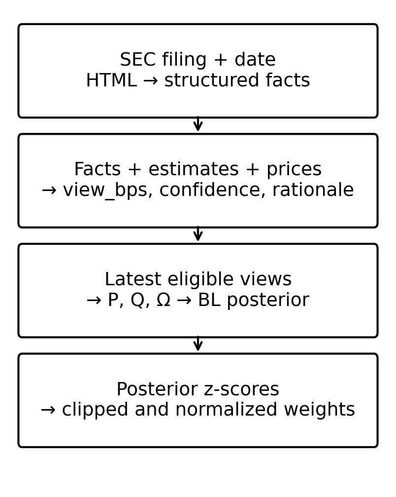
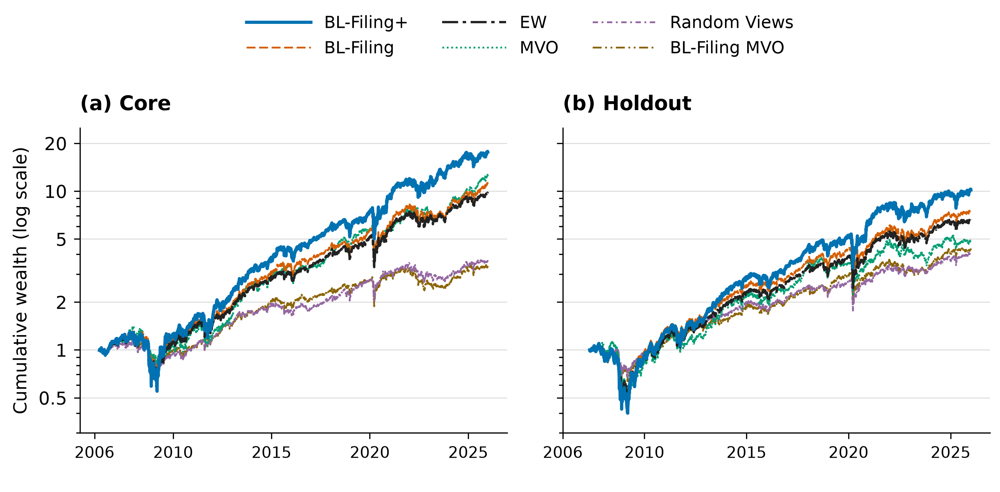
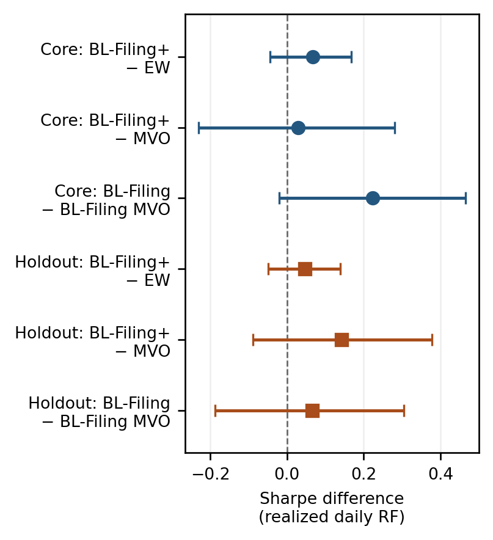

# Evaluating LLM-Based Integration of Corporate Filings into Black–Litterman Portfolio Construction

Oleksii Ivanov¹, Vitaliy Kobets¹*

¹ Kherson State University, 27 Universitetska St., Kherson 73003, Ukraine

E-mail: oleksii.ivanov@university.kherson.ua; vkobets@kse.org.ua

ORCID: Oleksii Ivanov 0000-0003-3824-3377; Vitaliy Kobets 0000-0002-4386-4103

* Corresponding author: Vitaliy Kobets (vkobets@kse.org.ua).

Keywords: large language models; SEC filings; Black–Litterman; portfolio construction; text ablation; retrospective evaluation

## Abstract

We evaluate an LLM-based pipeline that integrates corporate filings into Black–Litterman-based portfolio construction using 100 selected S&P 500 companies in two fixed groups through December 2025. BL-Filing+ achieves compound annual returns of 15.67% and 13.24%, compared with 12.19% and 10.66% for equal weighting, with greater volatility and drawdown. Using realized daily risk-free rates, its annualized arithmetic Sharpe ratios are 0.649/0.569 versus 0.581/0.522; paired intervals for the differences include zero. The return advantage persists at proportional trading costs of 5–20 basis points. Offline diagnostics identify the allocator’s contribution: prior-only tilting is numerically equivalent to a within-group beta tilt, and a volatility tilt gives Sharpe 0.695/0.565. Mean quarterly rank IC is −0.018/−0.021, and factor regressions leave incremental alpha over prior-only tilting unresolved. A separate ablation uses 1,791 Grok 4.3 responses on 199 inputs: removing or replacing filing summaries changes mean views by 26.88 or 36.88 basis points in absolute terms, and weight differences exceed average repeat variability in all four slices. The study provides a reproducible account of historical portfolio performance, text dependence and the allocation mechanism. Predictive value requires a temporally valid test because model information, universe selection and uncertain input vintages limit this retrospective evaluation.

Povzetek: Ocenjujemo vključevanje poročil podjetij in ocen velikega jezikovnega modela v oblikovanje portfeljev na osnovi modela Black–Litterman. Konfiguracija BL-Filing+ doseže višjo zgodovinsko sestavljeno donosnost kot enakomerno utežen portfelj, vendar ob večji volatilnosti in večjem največjem padcu. Povprečni četrtletni rangovni korelaciji ocen z naslednjimi donosi sta −0,018 in −0,021; intervala zaupanja vključujeta nič. Preproste kontrolne konfiguracije brez jezikovnega modela dosežejo primerljive Sharpeove količnike. Ločen preizkus na 199 vhodih pokaže, da povzetki poročil vplivajo na ocene in uteži. Rezultati zato ločujejo odvisnost od besedila od nepotrjene napovedne in dodatne portfeljske vrednosti ocen. Retrospektivna uporaba modela, izbor podjetij in negotova zgodovinska razpoložljivost podatkov ostajajo omejitve.

## 1 Introduction

Corporate filings contain descriptions of business risks, management guidance and corporate events that are difficult to express as a small set of numerical indicators. An LLM can convert these descriptions into structured records and then into a numerical investment view. A portfolio system must still decide what that number means, how much confidence to assign to it and how to translate it into weights. These decisions can affect the result as much as the text-processing stage.

Black–Litterman (BL) provides a framework for combining a prior return vector with uncertain views [1]. Estimation error remains relevant: portfolio choice can be sensitive to errors in expected returns [2], and equal weighting is a demanding benchmark for estimated portfolio rules [3]. Evaluating a language-model portfolio therefore requires comparisons that distinguish its numerical views from its allocation rule, view filter and risk exposure.

This paper evaluates how structured filing information enters a Black–Litterman-based portfolio pipeline. A first model call extracts structured filing facts; a second combines them with numerical context and returns a bounded view, a confidence label and a rationale. The portfolio layer combines accepted views with an equal-weight reference prior and converts posterior scores into tilted weights. Saved optimizer-based configurations provide additional comparisons. The contribution is an empirical evaluation of this integration: historical portfolio outcomes are examined alongside controls for numerical view assignment and repeated interventions on the supplied text.

The evaluation addresses three questions. First, how does the complete configuration perform relative to equal weighting and the other saved configurations? Second, do filing summaries affect generated views and portfolio weights when financial context is held fixed? Third, does the assignment of numerical views to individual stocks add performance beyond matched allocation controls? Sections 5.1–5.2 report historical return and risk, Section 5.3 examines text dependence, Section 5.4 presents matched controls and masking, and Section 5.5 tests quarterly signal and simple risk-based explanations.

The historical views were generated with Grok 4.1 Fast. The content and identifier-masking experiments use Grok 4.3 on four portfolio slices and do not generate a replacement historical backtest. This separation allows the evaluation to report the observed return advantage of the complete configuration while testing which stronger explanations the available evidence supports.

## 2 Related work

Financial text analysis has developed from domain-specific dictionaries to contextual language models. Loughran and McDonald [4] showed why financial text requires vocabulary adapted to its domain. FinBERT [5] applies pretrained language representations to financial sentiment analysis. These approaches motivate extracting information from disclosures, but a sentiment classifier and a portfolio view generator have different outputs and evaluation targets. Classification quality alone does not determine the usefulness of the resulting portfolio weights.

Our earlier study combined filing sentiment and financial indicators to analyse financial impact [6]. The present work uses structured risk, guidance and event records as an inspectable intermediate representation and evaluates their use in portfolio construction. Corpus-wide factual validation and the comparison of one-stage with two-stage processing are separate engineering questions, addressed in the companion manuscript disclosed in Section 6.

Two closely related studies connect language-model outputs with BL. Mantshimuli and Mwamba [7] examine sentiment aggregation within a BL framework. Lee et al. [8] convert LLM forecasts and uncertainty into portfolio views using recent stock, sector and market information. Their published protocol uses a different asset selection and evaluation period. Our inputs include filing-derived structured facts, and our evaluation uses saved long-horizon portfolio series plus a separate repeated-input diagnostic. The studies do not share data or a common evaluation protocol, so their reported performance cannot be ranked directly against ours. Supplementary Table S5 compares the available evidence on their inputs, outputs and evaluation designs.

Recent work treats identity and temporal validity as explicit evaluation problems. BlindTrade [9] combines anonymized inputs, language-model features and graph/reinforcement-learning allocation, with cross-sectional shuffle controls. FinCAD [10] intervenes in decoding to attenuate historical memory, whereas our masking diagnostic changes inputs. Kong et al. [11] discuss interacting biases in financial LLM evaluation. Lopez-Lira and Tang [12] evaluate headline-based forecasts using post-knowledge-cutoff news. Lopez-Lira, Tang and Zhu [13] show why observations within a model’s training period can confound forecasting skill with memorization, including after entity masking. Together, these studies motivate separate tests of text dependence, signal assignment and temporal validity.

The distinction between generating a view and allocating from it is central here. In the implemented BL-Filing configurations, the posterior is standardized across stocks before tilting weights. In the optimizer-based configurations, the return vector enters an optimization objective. These transformations can produce different concentration and risk even when both are described as using BL. Moreover, the saved configurations differ in confidence filtering. Their comparison measures complete configurations; it does not isolate the effect of the allocation rule.

## 3 Evaluated filing-to-portfolio pipeline

### 3.1 Data and intermediate representations

The audited local collection contains 9,117 filing HTML files and 9,101 extraction JSON files. Of the extraction files, 1,100 predate 2006 and 8,001 fall in 2006–2025; the latter map one-to-one to 8,001 saved views. Sixteen HTML files have no extraction output. View dates are one calendar day after the associated filing dates. Supplement S11 records the inventory and matching checks for the 100-company corpus. SEC Forms 10-K and 10-Q provide the disclosure text. Financial Modeling Prep supplied market data, financial statements, analyst estimates and filing metadata. The universe configuration records 23 January 2026 as the selection date. Its stated criteria are complete 10-K/10-Q links and analyst estimates for 2006–2025, with sector coverage, among then-current S&P 500 constituents. These are recorded selection criteria, not independent proof of complete historical availability. It is not a reconstructed sequence of historical index memberships.

Each company belongs to one of two fixed 50-stock groups, labelled Core and Holdout in the saved artifacts. We retain those labels for traceability; Holdout means cross-sectional separation by company. Both groups share calendar conditions, data preparation and model choices, and Core results informed configuration development. Temporal validity and universe-selection limitations are discussed in Section 6.

The extraction stage processes relevant filing sections, including risk factors and management discussion, with chunking where required. The schema records categorized risks and severity, management guidance, overall sentiment, corporate events and competitive-position information. The risk taxonomy has 19 categories. Instructions permit absent information to be returned as null. Schema validation checks output structure; it cannot establish that a statement is supported by the filing. Intermediate JSON records allow later inspection and permit the reasoning stage to be rerun without repeating extraction.

An initial five-document model comparison informed the choice of Grok 4.1 Fast. This was a development exercise; corpus-wide extraction accuracy was outside its scope. The extraction temperature was 0.1 and the reasoning temperature was 0.3.

### 3.2 Numerical views

The reasoning prompt combines the extracted filing facts with earnings and revenue information, analyst-estimate context and recent price behaviour. It requests three fields: an integer view_bps in [−300, 300], confidence in {low, medium, high}, and a short reasoning string. The prompt describes view_bps as an expected quarterly excess return. The rationale is retained as an explanation of the model output; it is not an independent verification of the underlying facts or the forecast. The historical parser clamps integer views to the allowed range and supplies defaults for unrecognized confidence labels or short explanations. Its saved outputs therefore cannot be assigned the strict no-repair validity rate measured in the new diagnostic.

During development, very large EPS surprises were traced to mismatched earnings definitions. Inputs with absolute surprise above 200% were set to zero before regenerating affected views. This is a heuristic treatment of incompatible inputs. It does not reconstruct historical analyst-estimate vintages. An audit of all 100 saved analyst-estimate files, containing 9,465 records, found period dates but no independent as-of or revision timestamps. The matching routine accepts estimates within five days of the target fiscal-period date. This cannot establish when those estimates became observable. Price context is filtered to dates no later than the filing date, which also does not establish intraday availability.

At each quarterly rebalance, the system chooses the latest eligible view for each ticker, with a maximum age of 120 days. The filing-date filter excludes later-dated saved views. Stocks without an accepted view remain represented through the prior. Figure 1 shows the computational stages and stored intermediate artifacts.

### 3.3 BL integration and implemented units

Let Σ denote the annualized covariance estimate from a rolling 252-trading-day window. We use Ledoit–Wolf shrinkage [14]. With an equal-weight reference vector w_eq and risk-aversion parameter δ = 2.5, the prior is π = δΣw_eq. This reference is equal weighted rather than a market-capitalization equilibrium portfolio. The uncertainty multiplier is τ = 0.05.

Each accepted absolute stock view contributes one row of a pick matrix P. Its numerical value is Q_i = view_bps_i / 10,000. The diagonal uncertainty matrix has Ω_ii = σ_i², where σ_i is 0.01, 0.03 or 0.05 for high, medium or low confidence, respectively. The implementation multiplies σ_i by 0.8 for filing sentiment labelled confident or concerned. Although analyst dispersion appears in the reasoning input, the saved portfolio execution does not pass it to this uncertainty adjustment.

The posterior vector is computed as:

μ = [(τΣ)⁻¹ + PᵀΩ⁻¹P]⁻¹ [(τΣ)⁻¹π + PᵀΩ⁻¹Q].  (1)

This equation describes the saved implementation, including a units limitation. The quarterly prompt output enters Q without conversion to an annual horizon, whereas Σ and π are annualized. The prompt also does not pin down an unambiguous excess-return benchmark that is enforced throughout the implementation. The numerical views therefore function as adjustment scores in this experiment. We do not interpret their basis-point magnitudes or confidence labels as calibrated forecasts. Section 5.5 separately reports a quarterly-horizon variant with Σ and π divided by four and Q and Ω unchanged. The ambiguous excess-return benchmark and uncalibrated uncertainty remain limitations of that variant.

Table 1. Implemented portfolio parameters. Limits on weights precede normalization; view units retain the historical mismatch described above.

| Component | Setting and units |
|---|---|
| Universe | 50 stocks per portfolio |
| Rebalance | Quarterly; latest view aged at most 120 days |
| Covariance | 252-day window; Ledoit–Wolf; annualized |
| Prior | Equal-weight reference; δ = 2.5; τ = 0.05 |
| View | Quarterly prompt; Q = view_bps / 10,000 |
| View uncertainty | σ = 0.01 / 0.03 / 0.05 for high / medium / low |
| Sentiment adjustment | σ multiplied by 0.8 for confident / concerned |
| Tilt | γ = 1.0; cross-sectional posterior z-scores |
| Clipping | [0.005, 0.10], then normalization |
| Cost | 0.001 × absolute traded weight |
| Return timing | Following trading day's close-to-close return |

### 3.4 Weight construction and execution

The tilting configurations standardize μ across the portfolio to obtain z_i = (μ_i − mean(μ)) / sd(μ). They then calculate preliminary weights v_i = (1/N)(1 + γz_i), with γ = 1.0 in the saved implementation. Values are clipped to [0.005, 0.10] and normalized to sum to one:

w_i = clip(v_i, 0.005, 0.10) / Σ_j clip(v_j, 0.005, 0.10).  (2)

The clipping limits apply before normalization. They are therefore not hard constraints on the final weights. Across the 80 saved target-weight records, BL-Filing+ retains all 50 stocks, with Core weights ranging from approximately 0.434% to 10.401% and Holdout weights from 0.436% to 10.523%. These realized bounds replace the stronger claim that every final weight lies between 0.5% and 10%.

Quarterly target weights are followed by daily drift. The engine uses adjusted close-to-close returns, applying new target weights to the following trading day's return. It does not simulate execution at the next opening price. Transaction costs are 0.001 times the sum of absolute changes from current drifted weights to target weights, charged at rebalance. This is a proportional turnover model, not an estimate of realized spread, market impact or opening-auction execution. Equal weighting can also incur rebalancing costs as weights drift.

Algorithm 1. Saved filing-to-portfolio procedure.

Step 1. For each quarterly rebalance date t, select the latest dated view per stock with age at most 120 days; apply the configuration's confidence and sign filters.

Step 2. Estimate annualized Σ from the preceding 252 trading days and set π = 2.5Σw_eq. Construct P, Q and diagonal Ω from the accepted views.

Step 3. Compute the posterior in (1). If no view is accepted, use equal weights; otherwise apply the configuration's tilting rule in (2) or its optimizer. The engine also uses its fallback when covariance estimation lacks sufficient observations.

Step 4. Charge 0.001 times the absolute trade from drifted current weights to the new target. Apply the target to the next trading day's close-to-close return and let weights drift until the next rebalance.

Step 5. Store target weights and daily returns. Evaluate all configurations on common dates within each stock group. Keep the saved historical outputs separate from alternative numerical protocols.

### 3.5 Compared configurations

BL-Filing+ accepts medium-confidence positive views and uses tilting. BL-Filing accepts medium-confidence views of either sign and uses the same tilting rule. BL-Filing MVO accepts all confidence levels and uses mean–variance optimization with the BL posterior. Their difference combines a view-filter difference with an allocation difference. The configuration labels are retained to make the new analysis traceable to the saved outputs.

Equal weighting (EW) targets 1/N. Historical MVO uses a rolling historical arithmetic mean and covariance with a long-only 10% weight cap. Random Views draws numerical views from a zero-mean normal distribution with standard deviation 84.5 basis points and uses the optimizer-based allocation path. It is one saved stochastic realization with a different allocation mechanism from BL-Filing+. It is included descriptively and cannot establish the incremental information value of filing content. The matched reassignment controls in Supplement S8 instead retain the tilting path.

## 4 Evaluation protocol

### 4.1 Reporting windows and metrics

We reanalyse saved daily-return files and replay diagnostic allocations from saved inputs without new model inference. The source return files extend to 21 January 2026. We exclude 13 observations in 2026 from each portfolio: Core then contains 4,969 observations from 3 April 2006 through 31 December 2025, and Holdout contains 4,701 from 27 April 2007 through 31 December 2025. No terminal liquidation is assumed.

CAGR is calculated from compounded portfolio wealth using 252 trading days per year. Volatility is the sample standard deviation of daily total returns multiplied by √252. The reported Sharpe is the annualized arithmetic daily ratio, √252 mean(r_t − RF_t) / sd(r_t − RF_t), using date-aligned realized RF from the Kenneth French data library [15]. Maximum drawdown is measured from cumulative wealth peaks. Serial dependence affects Sharpe inference and time aggregation [16]; block intervals below retain paired daily observations. Supplement S12 reconciles these figures with the earlier constant-2% convention.

The original stored metric labelled sharpe_ratio was (CAGR − 0.02) divided by annualized volatility. The audit preserves that legacy quantity separately. All main-text Sharpe estimates and comparisons now use the realized-RF definition; saved portfolio returns are unchanged.

### 4.2 Dependence-aware comparisons

We specify three contrasts in each portfolio: BL-Filing+ minus EW, BL-Filing+ minus MVO, and BL-Filing minus BL-Filing MVO. The last is a comparison of complete configurations. For each contrast we use 10,000 paired circular moving-block bootstrap draws, retaining the same sampled dates across strategies. Blocks contain 21 trading days in the main analysis; lengths of 5 and 63 provide sensitivity checks. We report percentile 95% intervals for differences in arithmetic Sharpe. Block resampling follows the general use of dependent observations in bootstrap inference [17].

These are pointwise, non-studentized intervals conditional on the saved strategies. A twenty-year return series can change its distribution across market regimes, and fixed-length blocks do not establish stationarity. The intervals also do not correct selection of portfolio settings during development. The analysis protocol was written before the new bootstrap calculations, but after inspection of the historical results; it is a post hoc reanalysis, not a preregistered investment test.

Separately, we test the mean of each paired daily-return difference using an intercept-only heteroskedasticity and autocorrelation consistent variance estimate with Bartlett weights [18]. The main lag is 21, with 5 and 63 as sensitivity settings. We use a finite-sample variance multiplier n/(n − 1), normal asymptotics and Holm correction [19] over the six contrasts within each reporting window and lag. This family correction does not account for the earlier search over strategies and settings. Annualized mean differences equal 252 times the daily mean difference; they are not differences in CAGR.

For comparisons between Core and Holdout, both portfolios are also evaluated over the common window beginning 27 April 2007. Relative Sharpe change is 100(1 − S_Holdout/S_Core). It is descriptive and must not be interpreted as a statistical generalization guarantee. The Core and Holdout stocks share market conditions and are not independent replications of time.

### 4.3 Controls and input interventions

The filing-summary ablation holds financial context fixed and compares own, absent and reassigned summaries (Section 5.3). Historical controls retain the tilting rule and compare real views with conditional prior-only tilting and 100 within-date permutations per reassignment scheme. A separate repeated experiment removes explicit company names and tickers before reasoning. Section 5.4 describes these controls and their principal results; Supplements S4 and S8–S10 give full protocols and outputs. These interventions test different components and do not remove temporal information leakage.

## 5 Results

### 5.1 Portfolio performance

Tables 2 and 3 report performance through December 2025. BL-Filing+ achieves CAGR of 15.67% in Core and 13.24% in Holdout, compared with 12.19% and 10.66% for EW. It also has the highest point estimate of arithmetic Sharpe among the six saved configurations in both portfolios. Its volatility and maximum drawdown are larger than EW. The Core drawdown is −57.4% for BL-Filing+ versus −52.5% for EW; Holdout drawdown is −63.6% versus −56.6%. A return improvement should therefore not be read as a reduction in downside exposure.

Table 2. Core performance, 3 April 2006–31 December 2025. Return, volatility and drawdown are percentages.

| Strategy | CAGR % | Vol. % | Sharpe | Max DD % |
|---|---|---|---|---|
| BL-Filing+ | 15.67 | 24.57 | 0.649 | -57.40 |
| BL-Filing | 13.01 | 22.39 | 0.586 | -54.68 |
| EW | 12.19 | 20.65 | 0.581 | -52.55 |
| MVO | 13.62 | 21.86 | 0.619 | -43.08 |
| Random Views | 6.73 | 15.46 | 0.393 | -38.59 |
| BL-Filing MVO | 6.27 | 15.71 | 0.362 | -39.69 |

Table 3. Holdout performance, 27 April 2007–31 December 2025. Definitions match Table 2.

| Strategy | CAGR % | Vol. % | Sharpe | Max DD % |
|---|---|---|---|---|
| BL-Filing+ | 13.24 | 24.72 | 0.569 | -63.65 |
| BL-Filing | 11.47 | 21.94 | 0.539 | -59.95 |
| EW | 10.66 | 20.82 | 0.522 | -56.58 |
| MVO | 8.82 | 22.31 | 0.426 | -56.60 |
| Random Views | 7.78 | 16.09 | 0.457 | -39.15 |
| BL-Filing MVO | 8.09 | 16.17 | 0.473 | -41.26 |

The saved target weights describe allocation differences. BL-Filing+ holds all 50 stocks, but its mean effective number of holdings, 1/Σw_i², is 29.23 in Core and 29.82 in Holdout at executed targets. BL-Filing MVO averages approximately 18.4 positive positions in Core and 21.0 in Holdout; historical MVO averages 11.2 and 13.7. These measures describe different aspects of concentration.

Figure 2 presents wealth paths on a logarithmic scale. The saved Random Views configuration has lower point-estimate Sharpe than BL-Filing+ in both portfolios; it uses a different allocator and one stochastic realization. Matched controls for numerical view assignment are reported in Section 5.4.

### 5.2 Uncertainty and common-window comparison

The Core BL-Filing+ minus EW Sharpe difference is 0.067, with a 95% interval of [−0.045, 0.168]. The Holdout difference is 0.047, with [−0.048, 0.140]. All six main intervals include zero (Figure 3 and Table 4), leaving both modest benefits and adverse differences compatible with the data. A confidence interval containing zero is not an equivalence test.

Table 4. Arithmetic Sharpe differences and paired 95% moving-block bootstrap intervals; 21-day blocks, 10,000 draws. Realized daily RF; full configuration names are shown.

| Sample | Contrast | Difference | 95% interval |
|---|---|---|---|
| Core | BL-Filing+ − EW | 0.067 | [−0.045, 0.168] |
| Core | BL-Filing+ − MVO | 0.030 | [−0.231, 0.281] |
| Core | BL-Filing − BL-Filing MVO | 0.224 | [−0.020, 0.465] |
| Holdout | BL-Filing+ − EW | 0.047 | [−0.048, 0.140] |
| Holdout | BL-Filing+ − MVO | 0.143 | [−0.089, 0.378] |
| Holdout | BL-Filing − BL-Filing MVO | 0.066 | [−0.187, 0.305] |

The separate mean-return analysis gives an annualized Core BL-Filing+ minus EW difference of 3.94 percentage points, with Holm-adjusted p = 0.040. The corresponding Holdout difference is 3.20 percentage points, with adjusted p = 0.114. For BL-Filing versus BL-Filing MVO, Core gives 7.43 percentage points and adjusted p = 0.037. The remaining adjusted p-values exceed 0.05. These findings concern mean returns, not Sharpe differences, and remain conditional on the historical strategy selection.

On common dates, BL-Filing+ has Sharpe 0.647 in Core and 0.569 in Holdout, a relative decline of 12.1%. EW declines from 0.578 to 0.522, or 9.8%; historical MVO declines by 31.5%. These descriptive comparisons use the same calendar window, with the shared historical limitations discussed in Section 6.

The existing 36-configuration sensitivity grid contains 18 settings per stock group. At γ = 1.0, multiplying Q by four gives Sharpe 0.637/0.542; additionally multiplying Ω by sixteen gives 0.630/0.541. These are numerical scale scenarios. All 36 daily series have been recomputed with realized RF in Supplement S12. Their baseline returns match the primary files within 6 × 10⁻¹⁶. The archived fixed-rate projection and rounding checks remain available in Supplement S6.

### 5.3 Controlled filing-summary ablation

We test whether the second stage responds to filing summaries beyond the financial indicators already supplied. The experiment uses 199 available inputs across Core and Holdout on 30 September 2015 and 30 September 2025. Each input receives three fresh Grok 4.3 responses under each of three conditions: its own summaries, no summaries, and another company's summaries. The financial-context blocks, recipient header and system prompt are identical across conditions. A fixed permutation assigns a different donor within the same date and stock group; the same donor is used for all repetitions. The intervention changes saved 10-K/10-Q summary blocks, including their narrative numbers and sentiment, rather than re-extracting raw filings. Most donors are from a different sector, so mismatched context is part of the intervention.

All 1,791 responses are valid. Removing summaries changes condition-mean views by 26.88 basis points on average in absolute terms; replacing them changes views by 36.88 basis points. Mean cross-condition view distance exceeds average within-condition distance by 16.18 and 23.98 basis points, respectively. The signed own-summary minus no-summary average is only −0.37 basis points: changes across companies largely offset one another.

For each repetition, we construct weights using the same covariance, prior and positive/medium-confidence tilting rule. We fix uncertainty at σ = 0.03 for accepted views in every condition, removing the historical sentiment adjustment so that the no-summary condition cannot receive filing information through Ω. Table 5 compares the mean weight vectors using half their L1 distance. For own versus no summaries, cross-condition pair distance exceeds average within-condition distance by 3.96–10.86 percentage points of capital across the four slices; for own versus shuffled summaries, the excess is 5.41–13.54 points. Full repetitions and a fixed-support check appear in Supplement S10.

Table 5. Distance between mean portfolio weights, as a percentage of capital reallocated in one direction. Both columns compare the own-summary condition with the indicated alternative; each mean uses three full portfolio calculations. These are weight differences, not returns.

| Slice | No summaries % | Shuffled summaries % |
|---|---:|---:|
| Core 2015 | 16.19 | 23.08 |
| Holdout 2015 | 20.20 | 21.39 |
| Core 2025 | 12.46 | 10.82 |
| Holdout 2025 | 13.83 | 14.57 |

Filing-summary inputs affect numerical views and weights beyond the fixed financial context. Medium-confidence responses account for 85.26% with own summaries, 59.80% without summaries and 83.42% with shuffled summaries, so mismatched text also accompanies higher reported confidence. The four dependent slices and one donor permutation characterize input sensitivity; they do not measure forecast accuracy or explain the historical return advantage.

### 5.4 Matched allocation controls and identifier sensitivity

Table 6 compares BL-Filing+ with controls that retain its tilting mechanism. Reassignment results are medians across 100 seeds per scheme; they are descriptive control distributions, not confidence intervals. Conditional prior-only tilting removes numerical views and retains the original no-eligible-view fallback. At least one eligible view exists at every reported rebalance; an unconditional no-LLM prior tilt reproduces the same daily returns. It therefore does not retain an LLM-selected stock subset in this sample. Eligible-only reassignment preserves accepted stocks while permuting their view/uncertainty pairs; full reassignment also changes the recipient stocks.

Table 6. Arithmetic Sharpe under matched historical controls. Core and Holdout use the reporting windows in Tables 2 and 3. Reassignment rows report median seed Sharpe.

| Configuration | Core | Holdout |
|---|---|---|
| Real views (BL-Filing+) | 0.649 | 0.569 |
| Conditional prior-only tilt | 0.613 | 0.535 |
| Eligible-only reassignment | 0.645 | 0.562 |
| Full reassignment | 0.632 | 0.508 |
| Equal weighting | 0.581 | 0.522 |

Real-minus-prior-only Sharpe differences are 0.0355 in Core (95% interval [−0.0449, 0.1164]) and 0.0335 in Holdout ([−0.0396, 0.1062]). Comparisons against eligible-reassignment ensemble-mean daily returns give 0.0035 ([−0.0188, 0.0262]) and 0.0049 ([−0.0230, 0.0333]). Ensemble-mean comparisons differ from subtracting median seed Sharpe in Table 6. All real-minus-control intervals include zero at block lengths 5, 21 and 63 (Supplement S12).

The identifier-masking experiment uses 1,194 Grok 4.3 responses on 199 inputs, with three repetitions per condition. Removing explicit names and tickers changes mean portfolio weights by 6.84–12.47% of capital across the four slices. Average cross-condition pair distance minus average within-condition distance ranges from −0.61 to 1.74 percentage points and is positive in three slices. Thus repeat variability accounts for part of the apparent identity sensitivity. Other identity clues remain, and the experiment neither decontaminates the model nor provides a new return backtest (Supplement S9).

### 5.5 Quarterly signal and risk-based controls

We pair the latest available view, aged at most 120 days, with the next complete quarter’s price return on 79 rebalance dates per group. These are rebalance-date diagnostics, not fresh-filing event studies. Spearman IC uses average ranks; top-minus-bottom quintile spreads retain ties. Date-level inference uses Bartlett HAC with four lags. The two primary IC tests receive Holm correction. Confidence-stratified results and definitions appear in Supplement S11.

Table 7. Quarterly signal diagnostics. Hit rates exclude zero views and are averaged across dates. Quintile spreads are percentage points per quarter. Both primary IC Holm p-values are 0.563.

| Diagnostic | Core | Holdout |
|---|---:|---:|
| Mean rank IC | −0.018 | −0.021 |
| HAC t-statistic for IC | −0.994 | −1.077 |
| Top-minus-bottom spread, p.p. | −1.46 | −0.97 |
| Directional hit rate, % | 50.05 | 50.27 |
| Always-positive hit baseline, % | 60.31 | 59.71 |

IC intervals are [−0.054, 0.018] and [−0.060, 0.017]; both quintile-spread intervals also include zero. Medium-confidence IC is −0.013/−0.014. High-confidence views are too sparse for the minimum ten-stock cross-section. Absolute hit rates should be read against the positive-return baseline, since the prompt’s excess-return benchmark is ambiguous; hits relative to the group mean are 49.17%/49.48%. These checks do not establish a positive quarterly ranking signal.

Two controls apply the identical tilting rule to trailing 252-day beta or volatility, without LLM filtering. Beta is measured against the within-group equal-weight return. It reproduces prior-only weights to 1.3 × 10⁻¹⁶, with Sharpe 0.613/0.535. This follows algebraically: Ledoit–Wolf shrinkage toward a scalar identity adds a common component to Σ times equal weights; cross-sectional standardization removes that component and the positive scale. The remaining scores have the same z-scores as beta against the equal-weight return. Thus the prior-only result has a specific risk-exposure interpretation.

The volatility tilt gives CAGR 17.85%/13.63% and Sharpe 0.695/0.565, with volatility 26.29%/26.08%. BL-Filing+ minus volatility-tilt Sharpe is −0.0456 (95% interval [−0.1221, 0.0276]) and 0.0033 ([−0.0702, 0.0797]). Daily market, size, value and momentum regressions use realized RF from the Kenneth French data library [15] and HAC lag 21. Market, size and value series come from the cached FF5 file. BL-Filing+ market betas are 1.0352/1.0354, compared with 1.1111/1.1107 for prior-only; earlier equality at three decimals was rounding. Real-minus-prior annualized alpha is 0.36/0.63 percentage points (p = 0.709/0.504; Holm p = 1.000 for both). The FF5-plus-momentum sensitivity gives p = 0.891/0.602. Standalone alpha and incremental alpha answer different attribution questions.

A quarterly BL calculation using Σ/4 and π/4 with unchanged Q and Ω gives Sharpe 0.638/0.543. At unchanged τ, its weights equal the annual representation using 4Q and 4Ω, distinct from the earlier 4Q/16Ω uncertainty scenario. This checks horizon consistency. Supplement S11 preserves the fixed-rate subperiod and rolling-Sharpe diagnostics, factor regressions and inventory audit; S12 supplies the realized-RF reconciliation and publication checks.

### 5.6 Trading costs, selection sensitivity and precision

Annual L1 turnover is 2.24/2.44 for BL-Filing+, compared with 0.37/0.36 for EW; conventional one-way turnover is half these figures. Repricing the same trades at 5, 10 and 20 basis points per unit of L1 turnover gives BL-Filing+ CAGR of 15.80%, 15.67% and 15.41% in Core, and 13.38%, 13.24% and 12.97% in Holdout. EW ranges from 12.21% to 12.15% and from 10.68% to 10.62%, respectively. The return advantage persists under these proportional-cost scenarios; spread and market impact are outside the model.

For selection sensitivity, we apply the deflated Sharpe ratio (DSR) of Bailey and López de Prado [20]. The six saved strategies plus 18 sensitivity settings yield 24 candidate paths per group, or 23 after removing a duplicate. Using their observed daily-Sharpe dispersion and an assumed effective trial count of 24 gives DSR 0.987/0.984. Across assumed counts of 6–100, it ranges from 0.993 to 0.980 in Core and 0.988 to 0.981 in Holdout. These are moment-based probabilities relative to a selection-adjusted zero-Sharpe benchmark, not tests against EW or evidence for a filing signal. The trial count is a scenario because the complete development search is unavailable; candidate dependence and the unknown search distribution limit the correction. S12 also reports a separately labelled HAC probabilistic-Sharpe sensitivity.

A conditional precision calculation uses the paired 21-day-block standard error and a normal approximation at two-sided α = 0.05 and 80% power. Minimum detectable Sharpe differences against EW are 0.153/0.134, larger than the observed 0.067/0.047; against prior-only they are 0.115/0.105. These estimates describe the resolution of the saved series under the resampling assumptions. They are not observed-power estimates or guarantees for a future sample. S12 includes 5/63-day block and six-comparison Bonferroni sensitivity.

## 6 Discussion and limitations

The evaluation identifies a historical return advantage, measurable text dependence and a concrete allocation mechanism. BL-Filing+ has higher compound returns than equal weighting in both groups, with greater volatility and drawdown. Summary interventions change views and weights beyond average repeat variability in the four evaluated slices. Much of the Sharpe level is also reproduced by controls that remove or reassign numerical views.

With the equal-weight prior and cross-sectional standardization, prior-only tilting is a beta tilt. A volatility tilt gives comparable or higher point-estimate Sharpe. Quarterly IC, quintile spreads and real-minus-prior factor alpha leave the incremental contribution of the evaluated views unresolved. This conclusion concerns the tested representation, horizon and allocator; filing information may have value under other designs.

Temporal validity remains a limitation of the historical comparison. A retrospectively applied model may encode events after the filing date; date-filtered prompts and held-out companies cannot remove that knowledge. The fixed universe was selected in January 2026 and is not a dated history of S&P 500 membership. Companies that failed or left the index may be underrepresented, and common stocks do not imply equal selection bias across strategies with different weights. Analyst-estimate files also lack independent as-of vintages. The reported outcomes therefore describe performance conditional on the saved inputs and selected universe, not returns certified as achievable by a historically available system.

Implementation and development choices delimit the result. Quarterly view language enters an annualized BL calculation, and clip-then-normalize weights do not enforce final individual bounds. The horizon-aligned replay tests one repair on the saved views. Core results informed configuration choices; the DSR sensitivity in Section 5.6 addresses assumed search sizes, while Holm correction covers the specified mean-return contrasts. A deployment-oriented evaluation requires point-in-time inputs and a frozen method assessed on subsequently available data.

The companion manuscript, “Comparing LLM Pipeline Architectures for Portfolio Views from Financial Filings,” uses shared project data to evaluate one-stage and two-stage processing, quote verification and top/bottom stock selection. The present article concerns historical v1 BL configurations and second-stage input ablations. The companion’s returns are not treated as independent evidence here. This overlap and the different research questions are also disclosed in the cover letter.

## 7 Conclusion

This study evaluates the integration of structured corporate-filing information, numerical LLM views and Black–Litterman-based portfolio construction. In the historical sample, BL-Filing+ achieves compound annual returns of 15.67% in Core and 13.24% in Holdout, compared with 12.19% and 10.66% for equal weighting. The return advantage is accompanied by greater volatility and drawdown, while paired bootstrap intervals leave the Sharpe differences uncertain. These are results for the complete saved configuration in two fixed stock groups.

The ablation demonstrates text dependence of views and weights. The risk controls identify how the prior and allocator contribute to portfolio outcomes, while the signal and incremental-alpha tests define the limits of the current evidence. Together with reproducible cost, uncertainty and selection-sensitivity calculations, these results provide a basis for designing a subsequent point-in-time evaluation with a frozen model and specification.

## Data and code availability

Code, derived data and all supplementary materials are deposited together in the project GitHub repository [21]. The experiments/informatica_2026 package contains saved historical returns and weights and minimal records for 3,285 new model responses: 300 pilot, 1,791 content-ablation and 1,194 masking responses. The two 199-input experiments therefore account for 2,985 responses. The experiments/informatica_2026_signal_risk package supplies Section 5.5 and S11; experiments/informatica_2026_publication supplies the realized-RF, cost, DSR and precision audit in S12. Each package includes offline reproduction instructions and checksums, and the repository version history identifies the released files. No external supplementary archive is required. Raw FMP data, full requests and narrative model responses are excluded; SEC filings remain available from EDGAR. Reproduction from saved outputs requires no API calls, whereas repeating model inference requires external services and may produce different outputs.

## Use of generative AI

Grok 4.1 Fast generated the historical extraction and reasoning outputs. Grok 4.3 generated the separate content-ablation and identifier-masking responses. Codex assisted with code auditing, statistical reanalysis, manuscript preparation and formatting. Model outputs and AI-assisted text require author verification; generative AI does not replace responsibility for the research and its reporting.

## References

[1] F. Black and R. Litterman (1992). Global portfolio optimization. Financial Analysts Journal, 48(5), 28–43. https://doi.org/10.2469/faj.v48.n5.28

[2] V. K. Chopra and W. T. Ziemba (1993). The effect of errors in means, variances, and covariances on optimal portfolio choice. The Journal of Portfolio Management, 19(2), 6–11. https://doi.org/10.3905/jpm.1993.409440

[3] V. DeMiguel, L. Garlappi and R. Uppal (2009). Optimal versus naive diversification: How inefficient is the 1/N portfolio strategy? The Review of Financial Studies, 22(5), 1915–1953. https://doi.org/10.1093/rfs/hhm075

[4] T. Loughran and B. McDonald (2011). When is a liability not a liability? Textual analysis, dictionaries, and 10-Ks. The Journal of Finance, 66(1), 35–65. https://doi.org/10.1111/j.1540-6261.2010.01625.x

[5] D. Araci (2019). FinBERT: Financial sentiment analysis with pre-trained language models. arXiv:1908.10063. https://doi.org/10.48550/arXiv.1908.10063

[6] O. Ivanov and V. Kobets (2025). Future financial impact analysis from sentiment and indicators analysis. Computational Economics, 66(6), 4959–4985. https://doi.org/10.1007/s10614-025-10891-7

[7] L. A. Mantshimuli and J. W. M. Mwamba (2025). Enhancing portfolio optimization with multi-LLM sentiment aggregation: A Black–Litterman integration approach. Investment Management and Financial Innovations, 22(3), 213–226. https://doi.org/10.21511/imfi.22(3).2025.16

[8] Y. Lee, Y. Kim, J. Kim, S. Kim and Y. Lee (2025). LLM-Enhanced Black-Litterman Portfolio Optimization. arXiv:2504.14345. https://doi.org/10.48550/arXiv.2504.14345

[9] J. Jeon and H. Lee (2026). Can Blindfolded LLMs Still Trade? An Anonymization-First Framework for Portfolio Optimization. arXiv:2603.17692v1. https://doi.org/10.48550/arXiv.2603.17692

[10] W. W. Li, M. Wang and T. Ma (2026). Summoning the Oracle to Slay It: Mitigating Look-Ahead Bias in Financial Backtesting with Large Language Models. Proceedings of EMNLP 2026, 11694–11713. https://doi.org/10.18653/2026.emnlp-main.510

[11] Y. Kong, H. Lee, Y. Hwang, A. Lopez-Lira, B. Levy, D. Mehta, Q. Wen, C. Choi, Y. Lee and S. Zohren (2026). Evaluating LLMs in Finance Requires Explicit Bias Consideration. arXiv:2602.14233v1. https://doi.org/10.48550/arXiv.2602.14233

[12] A. Lopez-Lira and Y. Tang (2025). Can ChatGPT Forecast Stock Price Movements? Return Predictability and Large Language Models. arXiv:2304.07619v6. https://doi.org/10.48550/arXiv.2304.07619

[13] A. Lopez-Lira, Y. Tang and M. Zhu (2025). The Memorization Problem: Can We Trust LLMs’ Economic Forecasts? arXiv:2504.14765v2. https://doi.org/10.48550/arXiv.2504.14765

[14] O. Ledoit and M. Wolf (2004). A well-conditioned estimator for large-dimensional covariance matrices. Journal of Multivariate Analysis, 88(2), 365–411. https://doi.org/10.1016/S0047-259X(03)00096-4

[15] K. R. French. Data Library: Fama/French research factors and momentum factor, daily series. https://mba.tuck.dartmouth.edu/pages/faculty/ken.french/data_library.html. Cached snapshot dated 7 September 2026; accessed 16 November 2026.

[16] A. W. Lo (2002). The Statistics of Sharpe Ratios. Financial Analysts Journal, 58(4), 36–52. https://doi.org/10.2469/faj.v58.n4.2453

[17] H. R. Künsch (1989). The jackknife and the bootstrap for general stationary observations. The Annals of Statistics, 17(3), 1217–1241. https://doi.org/10.1214/aos/1176347265

[18] W. K. Newey and K. D. West (1987). A simple, positive semi-definite, heteroskedasticity and autocorrelation consistent covariance matrix. Econometrica, 55(3), 703–708. https://doi.org/10.2307/1913610

[19] S. Holm (1979). A simple sequentially rejective multiple test procedure. Scandinavian Journal of Statistics, 6(2), 65–70. https://www.jstor.org/stable/4615733

[20] D. H. Bailey and M. López de Prado (2014). The Deflated Sharpe Ratio: Correcting for Selection Bias, Backtest Overfitting and Non-Normality. The Journal of Portfolio Management, 40(5), 94–107. https://doi.org/10.3905/jpm.2014.40.5.094

[21] O. Ivanov and V. Kobets (2026). Filing-aware portfolio research: code, derived data and Informatica reproduction packages. GitHub repository. https://github.com/oleksii-ivanov-ksu/FilingAwareLLMViewsforPortfolioOptimization
