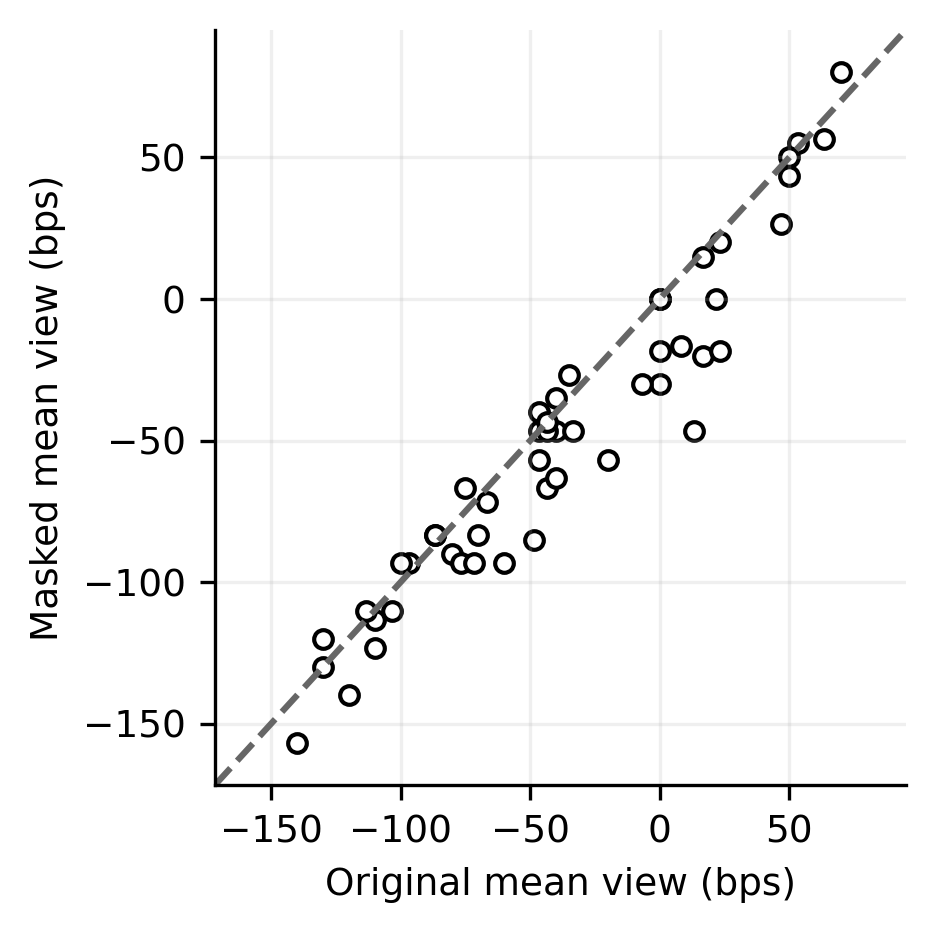
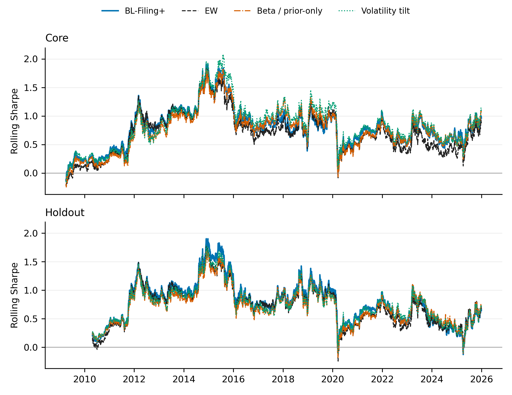

# Supplement to Evaluating LLM-Based Integration of Corporate Filings into Black–Litterman Portfolio Construction

## S1 Scope and provenance

This supplement reports the saved-return analysis, matched signal controls, identifier-masking diagnostics and filing-summary ablation. No historical extraction corpus or saved portfolio return file was overwritten. The revised analysis ends on 31 December 2025; it excludes the 13 later observations present in each source series. The primary reanalysis does not add liquidation costs; the matched-control simulations are described separately in S8.

The original metric labelled Sharpe was (CAGR − 0.02)/annualized volatility. The revised arithmetic Sharpe uses daily excess returns and sample standard deviation. The old paired test was a test of mean daily-return differences, not a test of Sharpe differences. These distinctions explain why figures in this revision differ from the submitted historical manuscript even though the saved in-period returns are unchanged.

## S2 Main comparisons

All tests compare paired daily series on the same dates. Sharpe intervals are percentile intervals from 10,000 circular moving-block draws. The main block length is 21 trading days. The JSON analysis also reports lengths of 5 and 63. Mean-return tests use HAC/Bartlett variance with lag 21 and the n/(n − 1) finite-sample multiplier. Holm correction covers three contrasts in each of two stock groups, not the earlier strategy search.

Table S1. Mean-return contrasts. Differences are annualized percentage points; adjusted p-values concern means, not Sharpe. F denotes BL-Filing, F+ BL-Filing+, and FM BL-Filing MVO.

| Sample | Contrast | Difference | Holm p |
|---|---|---|---|
| Core | F+ − EW | 3.94 | 0.040 |
| Core | F+ − MVO | 2.41 | 0.450 |
| Core | F − FM | 7.43 | 0.037 |
| Holdout | F+ − EW | 3.20 | 0.114 |
| Holdout | F+ − MVO | 4.56 | 0.344 |
| Holdout | F − FM | 4.18 | 0.344 |

The F versus FM contrast combines medium-only versus all-confidence filtering with tilting versus optimization. It cannot identify an isolated allocation effect. Random Views is descriptive because it uses a different allocator from F+ and represents only one saved stochastic run.

Table S2. Arithmetic Sharpe on common dates, 27 April 2007–31 December 2025. Relative change is 100(1 − Holdout/Core); a negative value indicates a higher Holdout value.

| Strategy | Core | Holdout | Relative change % |
|---|---|---|---|
| BL-Filing+ | 0.626 | 0.547 | 12.6 |
| BL-Filing | 0.553 | 0.515 | 6.9 |
| EW | 0.553 | 0.496 | 10.3 |
| MVO | 0.598 | 0.402 | 32.8 |
| Random Views | 0.362 | 0.424 | -16.9 |
| BL-Filing MVO | 0.312 | 0.440 | -40.9 |

## S3 Execution and numerical interpretation

The saved tilting strength is 1.0. The implementation clips preliminary weights to 0.005–0.10 and subsequently normalizes them. This does not enforce those bounds on the final weights. BL-Filing+ remains invested in all 50 stocks at each saved target date, but its maximum recorded target weight exceeds 10% in both groups.

The engine accounts for next-day close-to-close returns and drifting weights. Costs equal 0.001 times absolute traded weight. A next-open execution claim is unsupported by this engine. Target-to-target turnover metadata also differs from the turnover charged when current weights have drifted; zero change between consecutive equal-weight targets does not imply zero rebalancing cost.

The quarterly view is divided by 10,000 before entering an annualized BL calculation. No horizon conversion is applied in the historical implementation. Alternative scaling and final-constraint enforcement would define separate strategies. They must not be substituted for these saved returns without explicit relabelling. Earlier project sensitivity calculations are retained separately and are not pooled with the present main results.

## S4 Masking protocol and outcomes

The diagnostic sample contains one document from each of 50 companies, covering 11 sectors, with 25 Core and 25 Holdout documents, 25 annual and 25 quarterly filings, and 10 documents in each of five four-year intervals from 2006 to 2025. Selection also includes 20 historically positive, 20 negative and 10 neutral views. Neutral cases are deliberately overrepresented, so sample averages are not estimates of corpus-wide effects.

For each document, the original reasoning input is paired with an identifier-masked version. The experiment holds the saved first-stage extraction, system prompt, dates and numerical inputs fixed. Explicit names, tickers and additional identifying terms are replaced in the text. An agent reviewed all 50 pairs and added 295 replacements in 44 cases. This is not independent human annotation. Events and numerical patterns may still identify a company, while removing product or counterparty names can remove economically meaningful context.

The original model was unavailable through the execution route used for this diagnostic. We therefore ran a separate replication with x-ai/grok-4.3 through OpenRouter and the xAI provider, without fallback, search or external tools. Each condition received three independent requests in a saved randomized schedule, for 300 requests at temperature 0.3. Original-condition repeats provide a contemporaneous control for stochastic variation. Comparing only new masked outputs with old Grok 4.1 Fast outputs would confound masking with a model change.

The document is the analysis unit. We compare the means of the three responses in each condition. Outcomes include absolute and signed changes, changes among negative, zero and positive categories, and Spearman correlation. For each document, we also calculate the three pairwise within-condition distances in each condition and all nine cross-condition distances. The difference between cross-condition distance and average within-condition distance is diagnostic; it is not an unbiased causal-effect estimator. Confidence intervals use 10,000 document-level bootstrap draws with seed 20261116. The protocol and input hashes were frozen before the new responses were obtained.

All 300 requests returned valid outputs, with 300 unique generation identifiers, no HTTP retries and 50 complete document pairs. The reported total API cost was USD 0.66482175. Independent checksum validation covered 458 source dependencies. These checks establish execution completeness and input consistency; they are not a factual-accuracy assessment of the extracted content.

Table S3 reports the view-level changes. Seven documents change sign category: four reverse directly between positive and negative, and three involve zero.

Table S3. Document-level diagnostic outcomes in basis points unless indicated. Intervals are percentile 95% intervals from 10,000 resamples of the 50 documents.

| Outcome | Estimate | 95% interval |
|---|---|---|
| Absolute change of means | 13.57 | [10.13, 17.33] |
| Signed change of means | −10.77 | [−15.03, −6.77] |
| Original within distance | 14.00 | [10.67, 17.60] |
| Masked within distance | 16.27 | [13.20, 19.53] |
| Cross-condition distance | 17.54 | [14.39, 20.96] |
| Cross minus average within | 2.41 | [0.50, 4.67] |
| Changed sign category (%) | 14 | [6, 24] |

Spearman correlation between the two condition means is 0.9593 (Figure S1). The documents concern different companies and dates, so this is a cross-document diagnostic, not the rank correlation of stocks in a single investable portfolio. High correlation can coexist with a systematic downward shift and sign changes. It does not imply that masking leaves an allocation unchanged.

The result shows sensitivity to the text changed by masking. It cannot distinguish recognition of future company outcomes from loss of legitimate contextual information. The first-stage facts are unchanged and may themselves contain model-dependent errors or information. No historical portfolio was reconstructed using these new views, and the Grok 4.3 findings do not quantify the historical Grok 4.1 Fast strategy's contamination.

The first 100 calls were sequential. Four workers executed the remaining calls under an operational amendment; prompts, settings and schedule did not change. Preclaim markers protected against duplicate dispatch. The execution amendment and raw provider responses are retained. Confidence counts were 117 medium and 33 low for original inputs, and 111 medium and 39 low for masked inputs; neither condition returned high confidence.

## S5 Reproduction files and validation

The local financial package is data/v2/analysis/informatica_revision/financial_reanalysis_v1. It contains results.json, protocol.md and a snapshot of reanalysis.py. The current analysis entry point is scripts/v2/reanalyze_informatica_returns.py. The figures and tables are generated by scripts/v2/informatica_figures_and_tables.py. The frozen daily returns remain under data/results/core and data/results/holdout.

The pilot package is data/v2/analysis/informatica_revision/grok43_replication_v1. Its analysis.json and final_validation.json contain the statistics and validation results. Canonical inputs are under pilot_inputs_reviewed_v1, with pilot_preparation_v3 as upstream preparation. Other preparation directories are not alternative result sets. The source integrity check covered 458 dependencies; the finalized artifact inventory contains 613 checksums.

The bootstrap implementation was compared with explicit resampling on a synthetic paired series. HAC standard errors were checked against an independent statistical implementation. Input preservation and request completeness were checked separately from numerical analysis. These checks concern reproducibility of the calculations; they do not resolve temporal contamination, survivorship or data-vintage uncertainty.

The public replication package is available at https://github.com/oleksii-ivanov-ksu/FilingAwareLLMViewsforPortfolioOptimization (commit de10d6c), under experiments/informatica_2026. It includes saved portfolio returns and weights, all 36 sensitivity series, 300 minimal masking-pilot records, 1,194 minimal portfolio-masking records, 1,791 minimal text-ablation records, analysis scripts, pinned dependencies and SHA-256 checksums. Its offline verifier reruns the analyses and compares the results and tables without API calls. Full model messages and raw market inputs are excluded. Repeating model inference requires external services and may produce different outputs. No DOI has been assigned.

## S6 Saved numerical sensitivity grid

The archived grid contains 36 configurations: two stock groups, three Q/Ω scale pairs, two tilt strengths (0.5 and 1.0), and three allocation implementations (clip then normalize; projection enforcing final individual bounds; projection followed by rounding to a 1/10,000 grid). The same medium-confidence positive-view filter is used throughout this grid. Table S4 reports all three scales at the historical γ = 1.0 with the original allocation. All 36 rows are included in the replication package, rather than selecting only the best setting.

Table S4. Saved scale scenarios at γ = 1.0. These are descriptive results with the same arithmetic Sharpe convention as the main article.

| Sample | Scale Q / Ω | Sharpe | CAGR % |
|---|---|---|---|
| Core | 1 / 1 | 0.635 | 15.67 |
| Core | 4 / 1 | 0.623 | 15.29 |
| Core | 4 / 16 | 0.617 | 15.75 |
| Holdout | 1 / 1 | 0.547 | 13.24 |
| Holdout | 4 / 1 | 0.520 | 12.47 |
| Holdout | 4 / 16 | 0.521 | 12.94 |

Projection and subsequent rounding produce zero recorded individual-bound violations across their evaluated target records. The maximum absolute Sharpe changes are 0.000683 for projection and 0.0000973 for rounding. Each allocation type covers 918 valid target calculations across the dependent configurations and dates. This is not a count of independent experimental replications. A scale change cannot resolve the unspecified economic benchmark of the quarterly prompt or certify calibration of its uncertainty.

## S7 Related computational approaches

The comparison in Table S5 covers the closest cited approaches. Lee et al. and Mantshimuli and Mwamba were inspected in full text; the latter article was obtained from its institutional repository. For the newer studies, the relevant methodological and experimental sections were inspected. Performance figures across these designs are not directly comparable. Citation numbers refer to the main article.

Table S5. Inputs, view construction and evaluation.

| Study | Input and output | Evaluation |
|---|---|---|
| Mantshimuli and Mwamba [7] | Financial news; three sentiment models; LSTM price predictions converted to BL views | Ten stocks chosen by news mentions; monthly rebalancing; 2018–2023 evaluation; single-model and conventional portfolio comparisons |
| Lee et al. [8] | Two-week stock/sector/market returns and metadata; repeated forecasts determine view means and variances | 50 largest constituents selected in March 2025; June–August 2024 validation; September 2024–June 2025 test; biweekly rebalancing |
| Jeon and Lee [9] | Anonymized market/news features; graph encoder and RL allocation | Point-in-time constituents; cross-sectional shuffling; different allocation protocol |
| Li et al. [10] | Memory-sensitive decoding intervention | Comparisons before/after model cutoff; requires model-level decoding access |
| Present study | SEC-derived facts plus numerical context; bounded view and confidence labels; BL and weight tilting | Two fixed 50-stock groups through 2025; dependent-return inference; separate repeated masking diagnostic |

The primary difference from Lee et al. is the structured filing-fact interface and the role of uncertainty: their repeated forecast variance enters Ω, while the historical implementation here maps categorical labels to fixed uncertainty scales. The masking repetitions in this revision measure sensitivity and do not recalibrate the historical Ω. A broader calendar span is not evidence of greater temporal validity.

Mantshimuli and Mwamba describe a 50/30/20 chronological split in their data section but a different training proportion in Section 3.1.2. We therefore do not treat the reported split as an independently reproduced protocol. Their news-based sentiment and price-prediction route differs from the filing-fact interface evaluated here.

## S8 Matched controls and replication scope

Each stock group has 203 saved configurations: real views, conditional prior-only tilting, equal weighting, 100 full shuffles and 100 eligible-only shuffles. Joint view/uncertainty pairs move together; original confidence filtering precedes reassignment. All target weights and daily returns are retained. Real returns reproduce the frozen series within 6 × 10⁻¹⁶; an additional shuffled trajectory reproduces the shared trading engine within 5 × 10⁻¹⁷. Equal weighting does not require covariance and therefore rebalances when covariance-dependent strategies retain drifted weights after insufficient-history errors.

Full-shuffle 2.5th–97.5th seed percentiles are [0.525, 0.686] in Core and [0.439, 0.560] in Holdout. Eligible-only percentiles are [0.606, 0.648] and [0.520, 0.560]. These are descriptive ensemble ranges. The primary paired intervals use 21-day blocks and 10,000 draws, with 5/63-day sensitivity retained. Inference conditions on the saved ensemble; it does not include a nested resampling of seeds. No stronger conclusion about future-information contamination follows from these controls.

The matched-control directory is data/v2/analysis/informatica_revision/matched_controls_v1. Its protocol, input hashes, validation, per-seed statistics, turnover, targets and return series are stored separately from the earlier financial reanalysis. Turnover and concentration summaries exclude the target dated 31 December 2025, whose execution occurs after the reporting period.

We additionally compare BL-Filing+ with controls that retain its covariance estimate, prior, tilting rule, costs and reporting window. A conditional prior-only control removes views and tilts the prior, retaining the historical equal-weight fallback on dates without accepted views. Full shuffling reassigns accepted view–uncertainty pairs to random stocks in the same 50-stock universe. Eligible-only shuffling reassigns the same pairs within the originally selected companies. Both preserve the number and joint distribution of accepted positive, medium-confidence views. We run 100 fixed seeds for each shuffle family in each stock group, without permutations across dates or groups.

These controls were specified after the historical results were known. Full shuffling changes both company selection and signal assignment; eligible-only shuffling preserves selection. Reassignment can also change temporal persistence and exposure structure. Seed percentiles describe the control ensemble, not sampling confidence intervals or a valid causal randomization test. Paired block-bootstrap intervals compare real returns with the conditional prior and the mean daily return series of each ensemble. Such ensemble means are not median-seed performance or independently specified trading strategies.

The conditional prior-only control has Sharpe 0.600 in Core and 0.515 in Holdout, compared with 0.635 and 0.547 for real views. Median full-shuffle Sharpe is 0.617 and 0.486; 34 and 7 of the 100 seeds respectively match or exceed the real result. Eligible-only medians are 0.631 and 0.541, with 35 and 29 seeds matching or exceeding real performance. These counts are descriptive ranks within the constructed controls. Figure S2 summarizes the seed distributions.

Table S6. Real minus control arithmetic Sharpe, with paired 95% block-bootstrap intervals. Prior denotes conditional prior-only tilting; Full and Eligible denote the mean daily series of the corresponding 100-seed ensembles.

| Sample | Control | Difference | 95% interval |
|---|---|---|---|
| Core | Prior | 0.034 | [-0.047, 0.113] |
| Core | Full | 0.011 | [-0.061, 0.077] |
| Core | Eligible | 0.004 | [-0.019, 0.027] |
| Holdout | Prior | 0.032 | [-0.044, 0.106] |
| Holdout | Full | 0.051 | [-0.014, 0.115] |
| Holdout | Eligible | 0.005 | [-0.022, 0.034] |

All six intervals in Table S6 include zero; the corresponding intervals also include zero with 5- and 63-day blocks. Much of the observed Sharpe level persists with prior-only tilting and with reassignment among selected companies. The experiment therefore does not establish an incremental contribution from the exact view–uncertainty pairing with stocks. The gap between the two shuffle families is consistent with a role for company selection, but does not isolate that mechanism causally. The complete seed distributions and all daily series are retained.

## S9 Portfolio-slice masking and repeat variability

Checks cover 801 frozen input files and 997 source files; request payloads match the frozen inputs and source files remain unchanged. Historical portfolio targets are reproduced within 4.55 × 10⁻¹⁶ before applying new views.

Table S7. Mean cross-condition pair distance and its within-condition components, expressed as percentages of capital. E denotes the end-to-end positive/medium filter; F fixes historical support and Ω. Excess is cross minus the average of the two within-condition distances, in percentage points.

| Slice / mode | Original within | Masked within | Cross | Excess |
|---|---|---|---|---|
| Core 2015 / E | 13.99 | 14.01 | 13.39 | -0.61 |
| Core 2015 / F | 6.73 | 6.04 | 6.16 | -0.22 |
| Holdout 2015 / E | 16.39 | 11.16 | 13.99 | 0.22 |
| Holdout 2015 / F | 6.38 | 10.99 | 8.09 | -0.60 |
| Core 2025 / E | 6.38 | 7.62 | 8.74 | 1.74 |
| Core 2025 / F | 4.00 | 3.57 | 3.99 | 0.21 |
| Holdout 2025 / E | 18.48 | 13.85 | 17.56 | 1.40 |
| Holdout 2025 / F | 6.27 | 5.35 | 6.77 | 0.96 |

The end-to-end accepted-view counts across the three original/masked repetitions are: Core 2015, (10, 12, 13)/(14, 12, 12); Holdout 2015, (20, 20, 19)/(15, 19, 18); Core 2025, (21, 23, 22)/(24, 23, 22); Holdout 2025, (21, 18, 16)/(18, 19, 17). Historical fixed-support counts are respectively 21, 29, 26 and 28 in every repetition. Mean-vector distances on fixed support are respectively 3.57%, 4.07%, 2.56% and 5.01%.

There are three within-condition pairs per condition and nine cross-condition pairs per slice. These pairs share requests and are not independent replications. Negative excess distances are possible with three repetitions; they do not imply that masking improves stability. Explicit names and tickers are removed, while other contextual clues remain. The intervention differs from the broader first pilot and the two diagnostics are not pooled. Neither diagnostic reruns extraction or certifies historical availability of the model or financial context.

The directory data/v2/analysis/informatica_revision/portfolio_masking_grok43_v1 retains responses, analysis, targets and validation. The local replication candidate contains saved weights and derived summaries for offline verification of distances; it excludes full API messages and does not regenerate model inference. Concentration summaries and per-repetition weights remain available in the saved analysis artifacts. No new portfolio-return claim is inferred from these two dates.

A second diagnostic uses complete stock-group slices on 30 September 2015 and 30 September 2025. These September quarter-ends were fixed ten years apart without optimizing their returns. Both 50-stock groups are retained. There are 199 eligible reconstructed reasoning inputs: MO has no view within 120 days in the 2025 Holdout slice and remains investable without a view in both conditions. Three original and three masked requests per input give 1,194 completed calls with the same Grok 4.3 settings as the first diagnostic.

This intervention removes recorded occurrences of explicit legal/short company names and tickers. All other text, financial numbers, dates, products and counterparties remain unchanged. It is narrower than the first pilot's masking and is not full anonymization. Reconstructed input summaries match the saved summaries, and numeric sequences are identical across conditions. Historical extraction and uncertain data vintages remain unchanged.

For each repetition, we form a full portfolio from the new positive, medium-confidence views using the historical covariance, prior and tilting rule. We compare the mean weight vectors and all within- and cross-condition pairs using half the L1 distance, interpreted as one-way reallocated capital. Cross-condition distance minus average within-condition distance distinguishes the observed contrast from repeat variability. It can be negative in a small sample. We also report concentration and accepted-view counts. A secondary diagnostic fixes the historical accepted companies and uncertainty values while replacing only Q, allowing negative new Q on this fixed support. It is a mechanism check, not the original positive-only strategy. Four dependent slices do not support population-level significance claims, and no new return backtest is inferred from these dates.

All 1,194 requests returned valid responses with unique generation identifiers; no request was retried. Provider-reported cost was USD 2.5373412. Table S8 reports the four complete portfolio slices. The distance between the mean original and masked weight vectors ranges from 6.84% to 12.47% of portfolio capital. However, average within-condition distance ranges from 7.00% to 16.16%. Cross-condition distance exceeds average within-condition distance by −0.61 to 1.74 percentage points. The mean-vector contrast therefore cannot be attributed entirely to identifier removal.

Table S8. One-way weight distances under repeated original and masked inputs. Mean shift compares the two mean weight vectors; Within averages within-condition pair distances; Excess subtracts Within from the mean cross-condition distance. Excess is in percentage points. Each condition has three repetitions.

| Slice | Mean shift % | Within % | Excess % |
|---|---|---|---|
| Core 2015 | 7.19 | 14.00 | -0.61 |
| Holdout 2015 | 9.52 | 13.77 | 0.22 |
| Core 2025 | 6.84 | 7.00 | 1.74 |
| Holdout 2025 | 12.47 | 16.16 | 1.40 |

On fixed historical support and uncertainty, mean-weight distances are 2.56–5.01%. These smaller distances are descriptive: historical support differs from the companies accepted by the new model, so the comparison does not identify how much of the primary contrast is caused by filtering. The distance decomposition and accepted-view counts are reported above. The four dependent slices do not establish a population masking effect or equivalence between conditions. They show why repeated portfolio weights must be examined alongside view-level sensitivity: variation between identical requests is substantial in this diagnostic.

## S10 Filing-summary ablation details

The protocol fixes 199 inputs and all 1,791 calls before execution. Grok 4.3 is accessed through OpenRouter/xAI, with no fallback, temperature 0.3, a 2,000-token output limit and JSON responses. Calls follow a randomized schedule; all three arms use fresh responses. The decision date is the portfolio quarter-end in every arm. The single within-date/group derangement uses seed 20261117 and is held fixed across repetitions. All donors share the recipient fiscal-period label, but 166 of 199 differ in sector. Residual company names and other identity clues remain in the donor blocks. This tests mismatched disclosure bundles, not a purely semantic intervention isolated from identity or sector conflict.

All 1,791 outputs are valid, with unique generation identifiers and no HTTP retries; provider-reported cost is USD 3.7563829. Validation checks 1,796 input files, 1,198 source files and every request payload. Source files remain unchanged. Independent calculations reproduce all 24 weight contrasts and 15 pooled/slice-specific view contrasts. These are arithmetic and provenance checks, not factual verification of the extracted summaries.

Table S9. View-level differences across all 199 inputs. A and B are conditions, within denotes their mean pairwise repeat distances, and excess subtracts average within from cross-condition distance. Abs. ΔQ is the average absolute difference between condition means. Units are basis points; sign changes include transitions to/from zero.

| A / B | Abs. ΔQ | Within A / B | Excess | Sign changes |
|---|---|---|---|---|
| Own / None | 26.88 | 13.97 / 12.46 | 16.18 | 43/199 |
| Own / Shuffled | 36.88 | 13.97 / 16.28 | 23.98 | 47/199 |
| Shuffled / None | 28.21 | 16.28 / 12.46 | 16.52 | 41/199 |

Table S10. Primary portfolio cross-condition distance minus average within-condition distance, in percentage points of capital. Every distance is half-L1. Each cross-condition mean contains nine dependent pairs; each within-condition mean contains three pairs.

| Slice | Own / None | Own / Shuffled | Shuffled / None |
|---|---|---|---|
| Core 2015 | 6.82 | 13.54 | 9.13 |
| Holdout 2015 | 10.86 | 10.06 | 9.14 |
| Core 2025 | 4.99 | 5.41 | 3.11 |
| Holdout 2025 | 3.96 | 5.98 | 6.13 |

The primary calculation uses positive medium-confidence outputs and sigma 0.03, with no sentiment adjustment. A secondary calculation includes every available case with the same sigma regardless of sign or confidence. On this common support, own/no-summary mean-weight distances are 12.07–17.52%, and own/shuffled distances are 17.23–25.12%. Numerical sensitivity therefore persists when filter membership is held fixed; this does not quantify the filtering contribution to the primary contrasts. In the 2025 Holdout slice MO has no eligible input and remains investable without a view in all arms.

Confidence counts across 597 responses per condition are: own summaries, 1 high/509 medium/87 low; no summaries, 0/357/240; shuffled summaries, 1/498/98. These are reported labels rather than calibrated probabilities. Per-repetition accepted-view counts, HHI, maximum weights, all view contrasts and target vectors are retained in text_ablation_grok43_v1/analysis.json and targets.json. The same numerical-context blocks remain in all conditions, including earnings and price information; no-summary does not mean an information-free prompt.

The slices share companies and dates; stocks and pairwise distances are not independent market replications. No new returns are generated, and model availability, universe selection and data-vintage limitations remain.

## S11 Offline signal and risk diagnostics

This extension uses saved views, prices, portfolio series and a cached factor file. No LLM requests were made. Its protocol was fixed before examining these diagnostic outputs, but after the historical portfolio results were known. These are post-hoc conditional diagnostics, not an independent validation set. The complete protocol and machine-readable results accompany the revision in signal_risk_v1.

### S11.1 Dates, outcomes and confidence

The audit maps all 8,001 views one-to-one to extracted filings dated in 2006–2025: view_date is filing_date plus one calendar day. For each of 79 business-quarter-end decision dates per group, the latest view no more than 120 calendar days old is paired with the price return from the last trading close at the decision date to the last trading close in the next calendar quarter. Only outcomes ending by December 2025 are included. Views can therefore be stale within the allowed window; the test concerns the implemented rebalance signal, not returns immediately after filing. Price endpoints must exist. Inference is conditional on the same saved price convention as the historical backtest.

IC is Spearman correlation with average ranks, requiring at least ten stocks and nonconstant scores. Date means receive Bartlett HAC inference with four lags and a finite-sample correction. For sparse confidence strata, lags count successive valid cross-sections rather than four consecutive calendar quarters; these strata are exploratory. The two all-confidence IC tests use Holm correction. The high-confidence stratum has no eligible ten-stock cross-section and is not assigned a zero IC.

Table S11. Confidence-stratified rank IC. Confidence-stratum p-values are unadjusted and exploratory; primary all-confidence Holm p = 0.563 in each group.

| Group | Confidence | Dates | Mean IC | HAC t | p |
|---|---|---|---|---|---|
| Core | all | 79 | -0.018 | -0.994 | 0.320 |
| Core | low | 54 | -0.006 | -0.252 | 0.801 |
| Core | medium | 79 | -0.013 | -0.518 | 0.604 |
| Core | high | 0 | NA | NA | NA |
| Holdout | all | 79 | -0.021 | -1.077 | 0.282 |
| Holdout | low | 48 | -0.065 | -1.995 | 0.046 |
| Holdout | medium | 79 | -0.014 | -0.610 | 0.542 |
| Holdout | high | 0 | NA | NA | NA |

Quintiles use average percentile ranks at or above 0.8 and at or below 0.2, with at least five distinct scores and ten observations. Ties are retained; bin counts can differ from exactly one-fifth. Spreads are equal-weight top-minus-bottom price returns, not net investable long-short portfolio returns. All-confidence mean spreads are −1.464 percentage points per quarter in Core (95% interval [−3.137, 0.209]) and −0.968 in Holdout ([−2.249, 0.313]). Hit rates exclude zero views; null tests for hit rates use 0.5. Absolute direction hits are 50.05%/50.27%, compared with an always-positive baseline of 60.31%/59.71% on the same nonzero-view observations. Relative-to-group-mean hits are 49.17%/49.48%. These definitions expose the ambiguity of the prompt's unspecified excess-return benchmark; they do not silently treat absolute return as its certified target.

An exploratory follow-up restricted IC to the positive medium-confidence views accepted by BL-Filing+. Mean IC is 0.015 in Core (77 eligible dates; 95% interval [−0.026, 0.056], p = 0.470) and 0.023 in Holdout (78 dates; [−0.024, 0.069], p = 0.342). These later, unadjusted tests are separate from the two primary tests and also do not establish a positive ranking signal.

### S11.2 Risk tilts and the prior mechanism

Both controls use the saved clip-then-normalize rule, strength 1, the same quarterly dates, 252-day estimation window, drift and 10-basis-point cost per unit of L1 traded weight. Volatility is trailing sample standard deviation. Beta is sample covariance with the within-group equal-weight daily return divided by that return's variance. Neither control filters stocks using LLM output. Historical insufficient-covariance fallbacks are shared and disclosed; no new lookback or tilt strength was selected from the results.

Let S be sample covariance, u = 1/N, and the shrunk covariance be Σ = aS + bI. Then Σu = aSu + (b/N)1. Beta against the equal-weight return is Su/(uᵀSu). For positive a and nonconstant scores, z(δΣu) = z(beta): standardization removes the common component and positive scale. Since the subsequent clipping and normalization are identical, the weights coincide. The observed maximum weight difference is 1.25 × 10⁻¹⁶ in each group. Unconditional prior-only returns also reproduce the saved conditional-prior control; its no-eligible-view fallback is inactive on every reported rebalance. This is an allocation identity under the specified estimator and allocator, not proof that all portfolio performance is explained by the market factor.

Table S12. Full-window risk-control performance. CAGR and volatility are percent per year; drawdown is percent. Sharpe retains the historical constant 2% risk-free rate.

| Group | Arm | CAGR | Vol. | Sharpe | Max DD |
|---|---|---|---|---|---|
| Core | real | 15.67 | 24.57 | 0.635 | -57.40 |
| Core | prior_only | 15.44 | 26.47 | 0.600 | -64.46 |
| Core | equal_weight | 12.19 | 20.65 | 0.565 | -52.55 |
| Core | beta_tilt | 15.44 | 26.47 | 0.600 | -64.46 |
| Core | volatility_tilt | 17.85 | 26.29 | 0.681 | -61.58 |
| Core | horizon_aligned | 15.70 | 25.36 | 0.624 | -58.97 |
| Holdout | real | 13.24 | 24.72 | 0.547 | -63.65 |
| Holdout | prior_only | 12.84 | 26.40 | 0.515 | -64.65 |
| Holdout | equal_weight | 10.66 | 20.82 | 0.496 | -56.58 |
| Holdout | beta_tilt | 12.84 | 26.40 | 0.515 | -64.65 |
| Holdout | volatility_tilt | 13.63 | 26.08 | 0.545 | -63.87 |
| Holdout | horizon_aligned | 12.80 | 25.53 | 0.522 | -65.43 |

Paired 21-day circular-block intervals use 10,000 draws. Real-minus-beta Sharpe is 0.0345 [−0.0460, 0.1136] in Core and 0.0321 [−0.0406, 0.1057] in Holdout. Real-minus-volatility Sharpe is −0.0465 [−0.1243, 0.0264] and 0.0022 [−0.0706, 0.0801]. These intervals condition on the saved series and do not correct the earlier strategy search.

### S11.3 Factor regressions

The cached Kenneth French file is the 7 September 2026 snapshot, ending 31 July 2026; only dates aligned with the through-2025 portfolio window enter estimation. The four-factor diagnostic uses market, SMB, HML and momentum; SMB and HML are drawn from the cached five-factor file, so this is not claimed to reproduce a separate canonical FF3-file specification. A six-factor sensitivity adds RMW and CMA. Daily returns are net of modelled transaction costs. Each regression includes an intercept; standard errors use Bartlett HAC lag 21 with finite-sample correction and normal-reference inference. Alpha is the daily intercept multiplied by 252. RF is subtracted from each strategy, but not again from a strategy-minus-control series. All daily dates match the factor file.

Table S13. Four-factor attribution. Alpha and intervals are percentage points per year. Raw p-values are reported; Holm correction for the two primary real-minus-prior contrasts gives 1.000 in both groups.

| Group | Arm | Alpha | 95% interval | Market beta | p |
|---|---|---|---|---|---|
| Core | real | 5.48 | [1.86, 9.11] | 1.035 | 0.003 |
| Core | prior_only | 5.13 | [1.73, 8.53] | 1.111 | 0.003 |
| Core | equal_weight | 2.27 | [0.18, 4.36] | 0.944 | 0.033 |
| Core | volatility_tilt | 7.29 | [3.44, 11.14] | 1.094 | 0.000 |
| Core | full_shuffle_mean | 4.62 | [1.76, 7.48] | 1.036 | 0.002 |
| Core | difference_prior_only | 0.36 | [-1.51, 2.23] | -0.076 | 0.709 |
| Core | difference_volatility_tilt | -1.81 | [-3.66, 0.05] | -0.059 | 0.056 |
| Holdout | real | 3.64 | [0.22, 7.06] | 1.035 | 0.037 |
| Holdout | prior_only | 3.01 | [-0.19, 6.22] | 1.111 | 0.065 |
| Holdout | equal_weight | 1.34 | [-1.04, 3.72] | 0.927 | 0.271 |
| Holdout | volatility_tilt | 3.83 | [0.36, 7.30] | 1.089 | 0.031 |
| Holdout | full_shuffle_mean | 1.85 | [-0.93, 4.62] | 1.025 | 0.193 |
| Holdout | difference_prior_only | 0.63 | [-1.21, 2.47] | -0.075 | 0.504 |
| Holdout | difference_volatility_tilt | -0.19 | [-2.08, 1.71] | -0.053 | 0.846 |

With FF5 plus momentum, real-minus-prior alpha is −0.13 percentage points per year in Core (p = 0.891) and 0.49 in Holdout (p = 0.602). Full-reassignment ensemble means and all 100 individual seed regressions are retained in factor_regressions.csv. Ensemble-mean daily returns are a diagnostic, not median seed Sharpe or a separately specified trading strategy. Standalone significance is not a test of incremental LLM value.

### S11.4 Horizon and subperiod sensitivity

The quarterly-horizon variant uses Σ/4 and π/4, keeping Q, Ω and τ unchanged. Its posterior multiplied by four equals the annual representation using 4Q and 4Ω; its standardized weights are identical. Scaling Ω by 16 is instead a distinct assumption about annual forecast-error variance relative to the prior uncertainty and is retained in the earlier sensitivity grid. Quarterly consistency does not supply the missing excess-return benchmark or calibrate uncertainty.

Table S14. Arithmetic Sharpe by calendar subperiod. The first period actually begins 3 April 2006 in Core and 27 April 2007 in Holdout; exact starts and ends are in subperiods.csv.

| Group | Period | Real | EW | Beta | Volatility | Quarterly BL |
|---|---|---|---|---|---|---|
| Core | 2006–2012 | 0.479 | 0.397 | 0.388 | 0.446 | 0.445 |
| Core | 2013–2019 | 1.066 | 1.049 | 1.077 | 1.248 | 1.055 |
| Core | 2020–2025 | 0.642 | 0.513 | 0.665 | 0.708 | 0.662 |
| Holdout | 2006–2012 | 0.363 | 0.310 | 0.340 | 0.364 | 0.346 |
| Holdout | 2013–2019 | 1.091 | 1.022 | 0.980 | 1.015 | 1.010 |
| Holdout | 2020–2025 | 0.494 | 0.434 | 0.501 | 0.532 | 0.494 |

Rolling arithmetic Sharpe uses a fixed 756-trading-day window and is saved for all six arms. It is descriptive: overlapping windows are not independent tests. Replacing the constant risk-free rate with the aligned realized French RF gives the following full-window values.

| Group | Real | Prior/beta | EW | Volatility | Quarterly BL |
|---|---|---|---|---|---|
| Core | 0.649 | 0.613 | 0.581 | 0.695 | 0.638 |
| Holdout | 0.569 | 0.535 | 0.522 | 0.565 | 0.543 |

### S11.5 Inventory, numerical audit and reproducibility

The local inventory contains 9,117 filing HTML files, 9,101 extraction JSON files and 8,001 view JSON files. Of the extraction files, 1,100 predate 2006; the other 8,001 map exactly to the 2006–2025 view records after the recorded one-calendar-day view-date shift. Sixteen HTML files have no extraction output (15 before 2006 and one MO filing dated 30 July 2025). This corrects the earlier wording that described 9,101 as downloaded documents and 8,001 as the entire extraction corpus.

The new model-response total is 3,285: 300 in the 50-input pilot, 1,791 in filing-summary ablation and 1,194 in portfolio-slice masking. The two 199-input experiments alone total 2,985; these are different scopes, not inconsistent response counts. No new responses were added for this diagnostic package.

CAGR, sample annualized volatility, arithmetic Sharpe and maximum drawdown were recomputed for all six original strategies. Holdout EW drawdown is −56.5806695% and MVO is −56.6014480%; both correctly round to −56.6%. Initial unit wealth is included when defining the running peak. Replayed real, prior and EW daily returns match saved series within 1.0 × 10⁻¹⁶; a new beta arm independently matches the shared engine within 2.8 × 10⁻¹⁷. An independent rank-correlation reconstruction agrees within 1.2 × 10⁻¹⁶. Source hashes remain unchanged.

Implementation assertions caught a business-quarter-end boundary error and an incorrect proposed annual covariance-equivalence check before interpreting portfolio outcomes. Both were corrected and failed artifacts retained locally. Hit-rate tests were explicitly centered at 0.5. The reported analysis is the validated final output, not those incomplete runs.

These checks do not remove model-training leakage, survivor selection, uncertain analyst-estimate vintages or development-selection effects. No deflated-Sharpe statistic is presented as if the complete historical search count were known.

