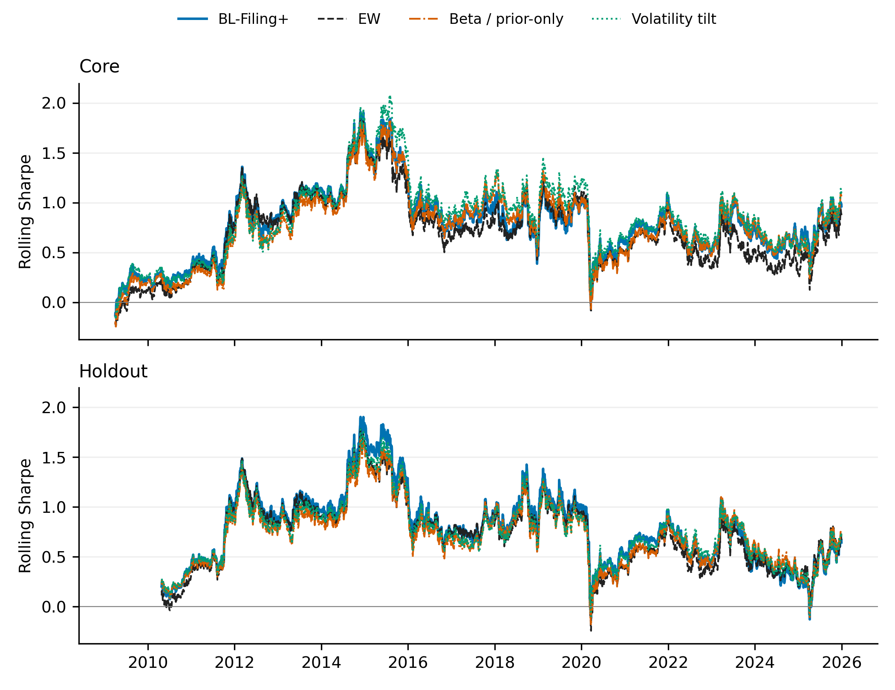

## S11 Offline signal and risk diagnostics

This extension uses saved views, prices, portfolio series and a cached factor file. No LLM requests were made. Its protocol was fixed before examining these diagnostic outputs, but after the historical portfolio results were known. These are post-hoc conditional diagnostics, not an independent validation set. The complete protocol and machine-readable results accompany the revision in signal_risk_v1.

### S11.1 Dates, outcomes and confidence

The audit maps all 8,001 views one-to-one to extracted filings dated in 2006–2025: view_date is filing_date plus one calendar day. For each of 79 business-quarter-end decision dates per group, the latest view no more than 120 calendar days old is paired with the price return from the last trading close at the decision date to the last trading close in the next calendar quarter. Only outcomes ending by December 2025 are included. Views can therefore be stale within the allowed window; the test concerns the implemented rebalance signal, not returns immediately after filing. Price endpoints must exist. Inference is conditional on the same saved price convention as the historical backtest.

IC is Spearman correlation with average ranks, requiring at least ten stocks and nonconstant scores. Date means receive Bartlett HAC inference with four lags and a finite-sample correction. For sparse confidence strata, lags count successive valid cross-sections rather than four consecutive calendar quarters; these strata are exploratory. The two all-confidence IC tests use Holm correction. The high-confidence stratum has no eligible ten-stock cross-section and is not assigned a zero IC.

Table S11. Confidence-stratified rank IC. Confidence-stratum p-values are unadjusted and exploratory; primary all-confidence Holm p = 0.563 in each group.

| Group | Confidence | Dates | Mean IC | HAC t | p |
|---|---|---|---|---|---|
| Core | all | 79 | -0.018 | -0.994 | 0.320 |
| Core | low | 54 | -0.006 | -0.252 | 0.801 |
| Core | medium | 79 | -0.013 | -0.518 | 0.604 |
| Core | high | 0 | NA | NA | NA |
| Holdout | all | 79 | -0.021 | -1.077 | 0.282 |
| Holdout | low | 48 | -0.065 | -1.995 | 0.046 |
| Holdout | medium | 79 | -0.014 | -0.610 | 0.542 |
| Holdout | high | 0 | NA | NA | NA |

Quintiles use average percentile ranks at or above 0.8 and at or below 0.2, with at least five distinct scores and ten observations. Ties are retained; bin counts can differ from exactly one-fifth. Spreads are equal-weight top-minus-bottom price returns, not net investable long-short portfolio returns. All-confidence mean spreads are −1.464 percentage points per quarter in Core (95% interval [−3.137, 0.209]) and −0.968 in Holdout ([−2.249, 0.313]). Hit rates exclude zero views; null tests for hit rates use 0.5. Absolute direction hits are 50.05%/50.27%, compared with an always-positive baseline of 60.31%/59.71% on the same nonzero-view observations. Relative-to-group-mean hits are 49.17%/49.48%. These definitions expose the ambiguity of the prompt's unspecified excess-return benchmark; they do not silently treat absolute return as its certified target.

An exploratory follow-up restricted IC to the positive medium-confidence views accepted by BL-Filing+. Mean IC is 0.015 in Core (77 eligible dates; 95% interval [−0.026, 0.056], p = 0.470) and 0.023 in Holdout (78 dates; [−0.024, 0.069], p = 0.342). These later, unadjusted tests are separate from the two primary tests and also do not establish a positive ranking signal.

### S11.2 Risk tilts and the prior mechanism

Both controls use the saved clip-then-normalize rule, strength 1, the same quarterly dates, 252-day estimation window, drift and 10-basis-point cost per unit of L1 traded weight. Volatility is trailing sample standard deviation. Beta is sample covariance with the within-group equal-weight daily return divided by that return's variance. Neither control filters stocks using LLM output. Historical insufficient-covariance fallbacks are shared and disclosed; no new lookback or tilt strength was selected from the results.

Let S be sample covariance, u = 1/N, and the shrunk covariance be Σ = aS + bI. Then Σu = aSu + (b/N)1. Beta against the equal-weight return is Su/(uᵀSu). For positive a and nonconstant scores, z(δΣu) = z(beta): standardization removes the common component and positive scale. Since the subsequent clipping and normalization are identical, the weights coincide. The observed maximum weight difference is 1.25 × 10⁻¹⁶ in each group. Unconditional prior-only returns also reproduce the saved conditional-prior control; its no-eligible-view fallback is inactive on every reported rebalance. This is an allocation identity under the specified estimator and allocator, not proof that all portfolio performance is explained by the market factor.

Table S12. Full-window risk-control performance. CAGR and volatility are percent per year; drawdown is percent. Sharpe retains the historical constant 2% risk-free rate.

| Group | Arm | CAGR | Vol. | Sharpe | Max DD |
|---|---|---|---|---|---|
| Core | real | 15.67 | 24.57 | 0.635 | -57.40 |
| Core | prior_only | 15.44 | 26.47 | 0.600 | -64.46 |
| Core | equal_weight | 12.19 | 20.65 | 0.565 | -52.55 |
| Core | beta_tilt | 15.44 | 26.47 | 0.600 | -64.46 |
| Core | volatility_tilt | 17.85 | 26.29 | 0.681 | -61.58 |
| Core | horizon_aligned | 15.70 | 25.36 | 0.624 | -58.97 |
| Holdout | real | 13.24 | 24.72 | 0.547 | -63.65 |
| Holdout | prior_only | 12.84 | 26.40 | 0.515 | -64.65 |
| Holdout | equal_weight | 10.66 | 20.82 | 0.496 | -56.58 |
| Holdout | beta_tilt | 12.84 | 26.40 | 0.515 | -64.65 |
| Holdout | volatility_tilt | 13.63 | 26.08 | 0.545 | -63.87 |
| Holdout | horizon_aligned | 12.80 | 25.53 | 0.522 | -65.43 |

Paired 21-day circular-block intervals use 10,000 draws. Real-minus-beta Sharpe is 0.0345 [−0.0460, 0.1136] in Core and 0.0321 [−0.0406, 0.1057] in Holdout. Real-minus-volatility Sharpe is −0.0465 [−0.1243, 0.0264] and 0.0022 [−0.0706, 0.0801]. These intervals condition on the saved series and do not correct the earlier strategy search.

### S11.3 Factor regressions

The cached Kenneth French file is the 7 September 2026 snapshot, ending 31 July 2026; only dates aligned with the through-2025 portfolio window enter estimation. The four-factor diagnostic uses market, SMB, HML and momentum; SMB and HML are drawn from the cached five-factor file, so this is not claimed to reproduce a separate canonical FF3-file specification. A six-factor sensitivity adds RMW and CMA. Daily returns are net of modelled transaction costs. Each regression includes an intercept; standard errors use Bartlett HAC lag 21 with finite-sample correction and normal-reference inference. Alpha is the daily intercept multiplied by 252. RF is subtracted from each strategy, but not again from a strategy-minus-control series. All daily dates match the factor file.

Table S13. Four-factor attribution. Alpha and intervals are percentage points per year. Raw p-values are reported; Holm correction for the two primary real-minus-prior contrasts gives 1.000 in both groups.

| Group | Arm | Alpha | 95% interval | Market beta | p |
|---|---|---|---|---|---|
| Core | real | 5.48 | [1.86, 9.11] | 1.035 | 0.003 |
| Core | prior_only | 5.13 | [1.73, 8.53] | 1.111 | 0.003 |
| Core | equal_weight | 2.27 | [0.18, 4.36] | 0.944 | 0.033 |
| Core | volatility_tilt | 7.29 | [3.44, 11.14] | 1.094 | 0.000 |
| Core | full_shuffle_mean | 4.62 | [1.76, 7.48] | 1.036 | 0.002 |
| Core | difference_prior_only | 0.36 | [-1.51, 2.23] | -0.076 | 0.709 |
| Core | difference_volatility_tilt | -1.81 | [-3.66, 0.05] | -0.059 | 0.056 |
| Holdout | real | 3.64 | [0.22, 7.06] | 1.035 | 0.037 |
| Holdout | prior_only | 3.01 | [-0.19, 6.22] | 1.111 | 0.065 |
| Holdout | equal_weight | 1.34 | [-1.04, 3.72] | 0.927 | 0.271 |
| Holdout | volatility_tilt | 3.83 | [0.36, 7.30] | 1.089 | 0.031 |
| Holdout | full_shuffle_mean | 1.85 | [-0.93, 4.62] | 1.025 | 0.193 |
| Holdout | difference_prior_only | 0.63 | [-1.21, 2.47] | -0.075 | 0.504 |
| Holdout | difference_volatility_tilt | -0.19 | [-2.08, 1.71] | -0.053 | 0.846 |

With FF5 plus momentum, real-minus-prior alpha is −0.13 percentage points per year in Core (p = 0.891) and 0.49 in Holdout (p = 0.602). Full-reassignment ensemble means and all 100 individual seed regressions are retained in factor_regressions.csv. Ensemble-mean daily returns are a diagnostic, not median seed Sharpe or a separately specified trading strategy. Standalone significance is not a test of incremental LLM value.

### S11.4 Horizon and subperiod sensitivity

The quarterly-horizon variant uses Σ/4 and π/4, keeping Q, Ω and τ unchanged. Its posterior multiplied by four equals the annual representation using 4Q and 4Ω; its standardized weights are identical. Scaling Ω by 16 is instead a distinct assumption about annual forecast-error variance relative to the prior uncertainty and is retained in the earlier sensitivity grid. Quarterly consistency does not supply the missing excess-return benchmark or calibrate uncertainty.

Table S14. Arithmetic Sharpe by calendar subperiod. The first period actually begins 3 April 2006 in Core and 27 April 2007 in Holdout; exact starts and ends are in subperiods.csv.

| Group | Period | Real | EW | Beta | Volatility | Quarterly BL |
|---|---|---|---|---|---|---|
| Core | 2006–2012 | 0.479 | 0.397 | 0.388 | 0.446 | 0.445 |
| Core | 2013–2019 | 1.066 | 1.049 | 1.077 | 1.248 | 1.055 |
| Core | 2020–2025 | 0.642 | 0.513 | 0.665 | 0.708 | 0.662 |
| Holdout | 2006–2012 | 0.363 | 0.310 | 0.340 | 0.364 | 0.346 |
| Holdout | 2013–2019 | 1.091 | 1.022 | 0.980 | 1.015 | 1.010 |
| Holdout | 2020–2025 | 0.494 | 0.434 | 0.501 | 0.532 | 0.494 |

Rolling arithmetic Sharpe uses a fixed 756-trading-day window and is saved for all six arms. It is descriptive: overlapping windows are not independent tests. Replacing the constant risk-free rate with the aligned realized French RF gives the following full-window values.

| Group | Real | Prior/beta | EW | Volatility | Quarterly BL |
|---|---|---|---|---|---|
| Core | 0.649 | 0.613 | 0.581 | 0.695 | 0.638 |
| Holdout | 0.569 | 0.535 | 0.522 | 0.565 | 0.543 |

### S11.5 Inventory, numerical audit and reproducibility

The local inventory contains 9,117 filing HTML files, 9,101 extraction JSON files and 8,001 view JSON files. Of the extraction files, 1,100 predate 2006; the other 8,001 map exactly to the 2006–2025 view records after the recorded one-calendar-day view-date shift. Sixteen HTML files have no extraction output (15 before 2006 and one MO filing dated 30 July 2025). This corrects the earlier wording that described 9,101 as downloaded documents and 8,001 as the entire extraction corpus.

The new model-response total is 3,285: 300 in the 50-input pilot, 1,791 in filing-summary ablation and 1,194 in portfolio-slice masking. The two 199-input experiments alone total 2,985; these are different scopes, not inconsistent response counts. No new responses were added for this diagnostic package.

CAGR, sample annualized volatility, arithmetic Sharpe and maximum drawdown were recomputed for all six original strategies. Holdout EW drawdown is −56.5806695% and MVO is −56.6014480%; both correctly round to −56.6%. Initial unit wealth is included when defining the running peak. Replayed real, prior and EW daily returns match saved series within 1.0 × 10⁻¹⁶; a new beta arm independently matches the shared engine within 2.8 × 10⁻¹⁷. An independent rank-correlation reconstruction agrees within 1.2 × 10⁻¹⁶. Source hashes remain unchanged.

Implementation assertions caught a business-quarter-end boundary error and an incorrect proposed annual covariance-equivalence check before interpreting portfolio outcomes. Both were corrected and failed artifacts retained locally. Hit-rate tests were explicitly centered at 0.5. The reported analysis is the validated final output, not those incomplete runs.

These checks do not remove model-training leakage, survivor selection, uncertain analyst-estimate vintages or development-selection effects. No deflated-Sharpe statistic is presented as if the complete historical search count were known.

